> [!NOTE]
> **This is a fork of [tangency-labs/solidcraft](https://github.com/tangency-labs/solidcraft) with a built-in gear drivetrain generator.**
> User guide: [docs/gears/](docs/gears/README.md) (start with the [quick start](docs/gears/quick-start.md)).
> The upstream SolidCraft README follows below the line.
> Work in progress, shared for testing: issues and pull requests are welcome here.

# Gears for SolidCraft

Draw your drivetrain in ordinary sketches, then click **Model › Create › Gears**. Each circle you
pick becomes a gear at the size you drew it. The whole drivetrain is built as **one editable Gears
feature**: the gear bodies, a revolute joint per shaft and a gear link per mesh, so turning one gear
turns the others. Change the sketch and the gears follow.

<p align="center">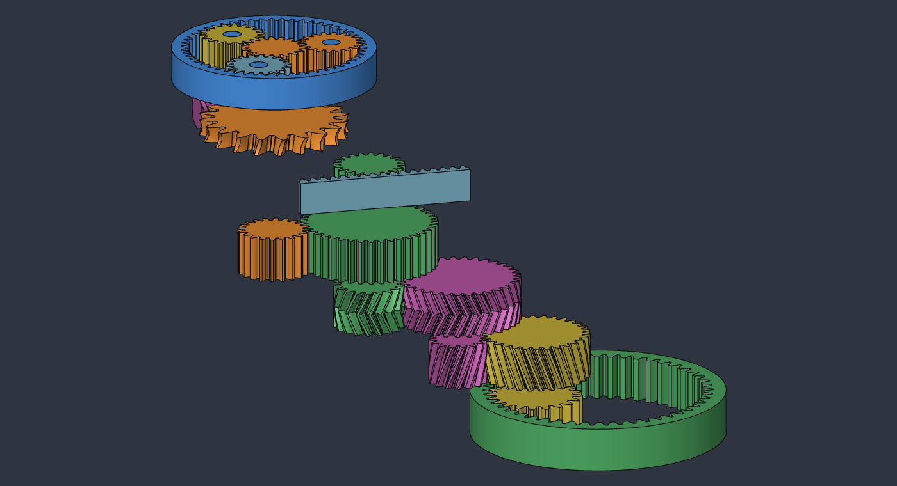</p>

<p align="center"></p>

<table align="center">
<tr><td align="center"><br/><sub>Spur</sub></td><td align="center"><br/><sub>Helical</sub></td><td align="center"><br/><sub>Herringbone</sub></td><td align="center"><br/><sub>Ring gear</sub></td><td align="center"><br/><sub>Rack</sub></td><td align="center"><br/><sub>Compound</sub></td></tr>
<tr><td align="center"><br/><sub>Planetary</sub></td><td align="center"><br/><sub>Bevel pair</sub></td><td align="center"><br/><sub>Hypoid pair</sub></td><td align="center"><br/><sub>Worm and wheel</sub></td><td align="center"><br/><sub>Crossed helical</sub></td><td align="center"><br/><sub>Shaft</sub></td></tr>
</table>

## Gear types

Every type below is made from the Gears dialog. How to sketch each one is in the
[gear types guide](docs/gears/gear-types.md); a larger gallery is in [docs/gears/GALLERY.md](docs/gears/GALLERY.md).

<table align="center">
<tr><td align="center" width="25%">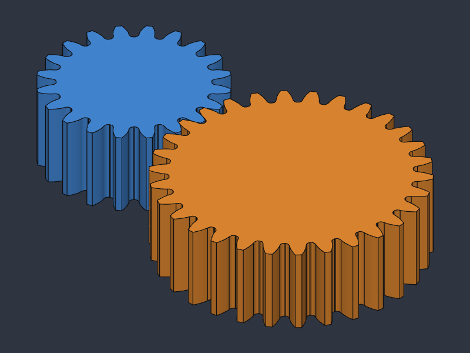<br/><b>Spur</b><br/><sub>a circle; touching circles mesh</sub></td><td align="center" width="25%"><br/><b>Helical</b><br/><sub>a circle; helix angle per gear</sub></td><td align="center" width="25%"><br/><b>Herringbone</b><br/><sub>a circle; V teeth</sub></td><td align="center" width="25%"><br/><b>Ring gear</b><br/><sub>ring circle + pinion circle touching inside</sub></td></tr>
<tr><td align="center" width="25%"><br/><b>Rack</b><br/><sub>a pitch line + the pinion circle tangent to it</sub></td><td align="center" width="25%">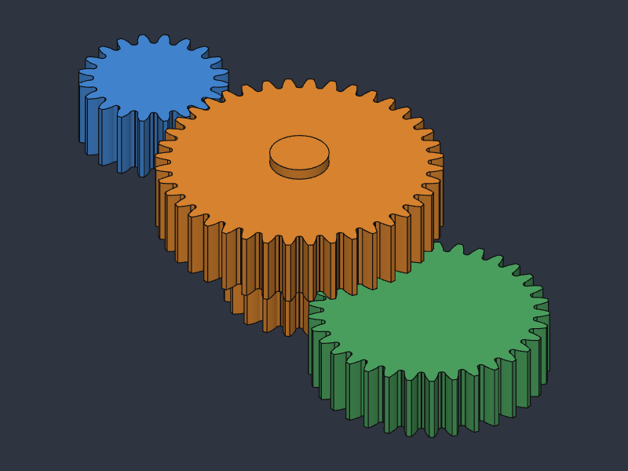<br/><b>Compound</b><br/><sub>a shaft line + circles in parallel sketches</sub></td><td align="center" width="25%">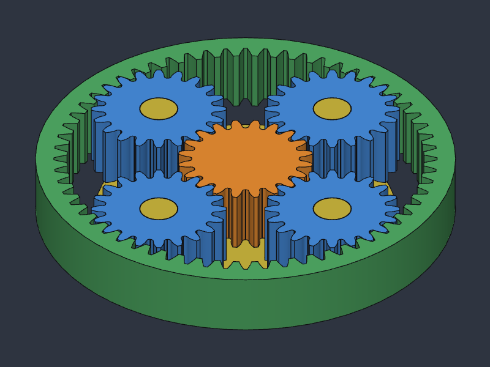<br/><b>Planetary</b><br/><sub>sun and ring concentric + one planet</sub></td><td align="center" width="25%">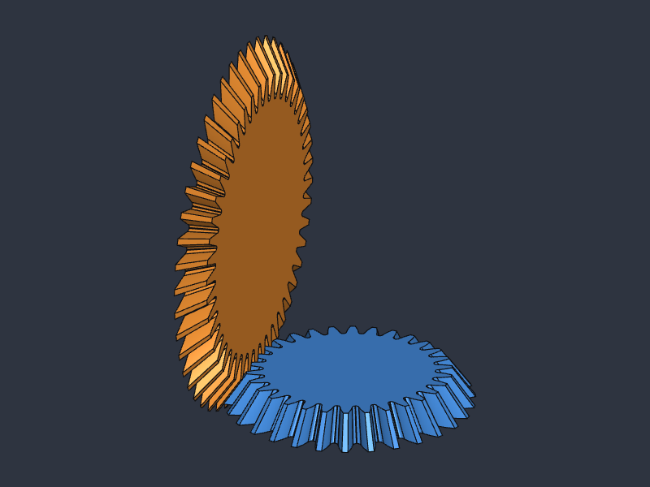<br/><b>Bevel, straight</b><br/><sub>side view: two shaft lines meeting at the apex</sub></td></tr>
<tr><td align="center" width="25%"><br/><b>Bevel, spiral</b><br/><sub>the same side view; Style: Spiral</sub></td><td align="center" width="25%"><br/><b>Bevel, chevron</b><br/><sub>the same side view; Style: Chevron</sub></td><td align="center" width="25%"><br/><b>Hypoid</b><br/><sub>ring circle + the pinion axis line, offset</sub></td><td align="center" width="25%">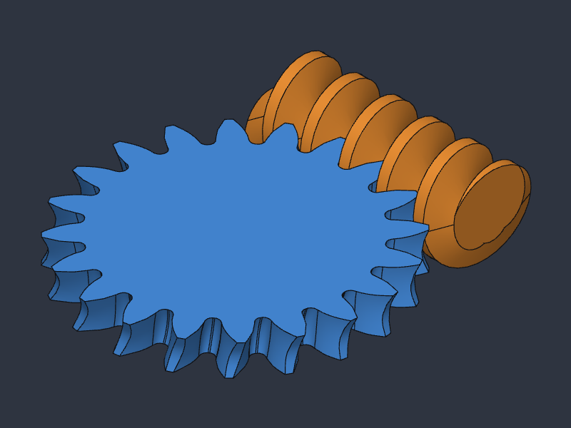<br/><b>Worm and wheel</b><br/><sub>wheel circle + the worm axis line in its plane</sub></td></tr>
<tr><td align="center" width="25%">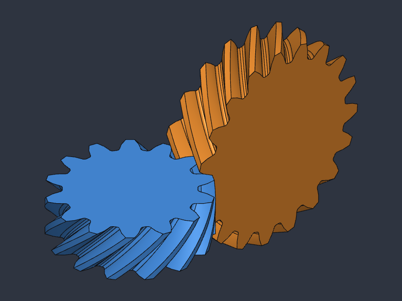<br/><b>Crossed helical</b><br/><sub>two circles on skew axes, touching</sub></td></tr>
</table>

<details>
<summary>Live previews from the earlier Gear Generator window (replaced in this branch)</summary>

These clips were captured from the earlier window's own 3D preview, which the Gears dialog doesn't have. The cycloidal gear is made only by the <code>gear.create</code> command in this build.

<table align="center">
<tr><td align="center"><br/><sub>Gear pair</sub></td><td align="center">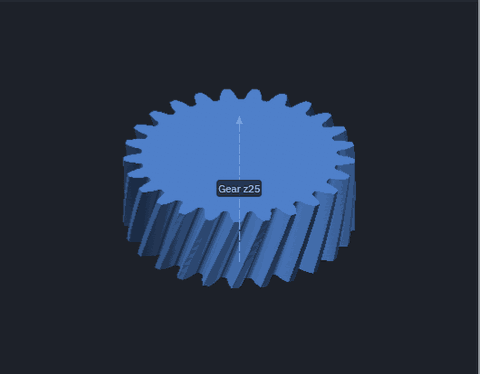<br/><sub>Helical</sub></td><td align="center">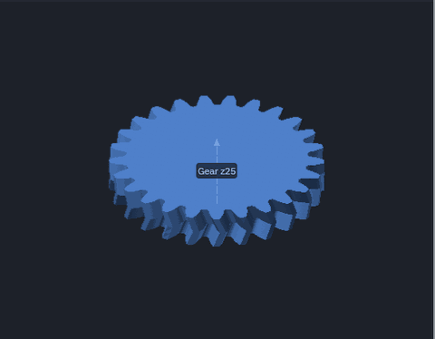<br/><sub>Herringbone</sub></td><td align="center">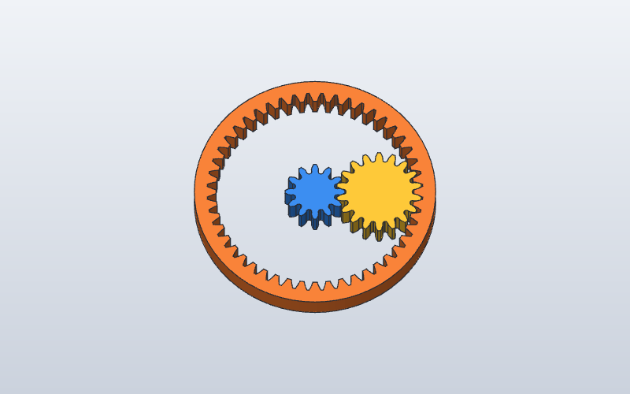<br/><sub>Internal ring</sub></td></tr>
<tr><td align="center">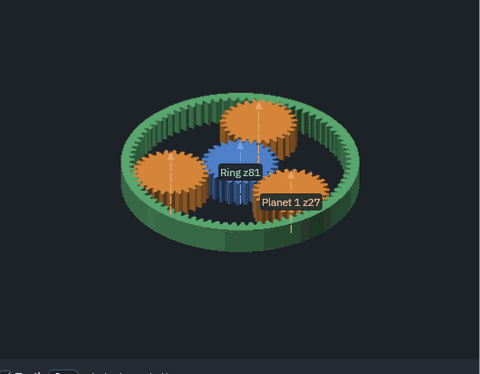<br/><sub>Planetary</sub></td><td align="center"><br/><sub>Straight bevel</sub></td><td align="center"><br/><sub>Spiral bevel</sub></td><td align="center"><br/><sub>Hypoid</sub></td></tr>
<tr><td align="center">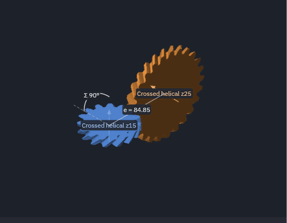<br/><sub>Crossed helical</sub></td><td align="center"><br/><sub>Worm and wheel</sub></td><td align="center">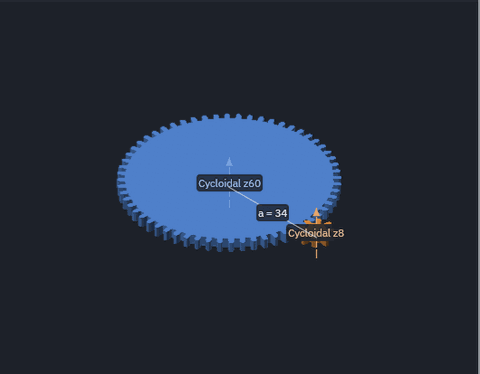<br/><sub>Cycloidal (command only)</sub></td></tr>
</table>

</details>

### What's new: the drivetrain feature

- **One Gears feature for a whole drivetrain.** Any number of gears and stages in one feature, one
  timeline row, one undo step. Edit it to change any gear; OK updates it in place.
- **Sketch-driven.** You draw with the normal sketch tools in as many sketches as you need. The
  drawn pitch diameter is kept; each gear takes the tooth count nearest it for the module, and the
  drawn centre distances are held by profile shift.
- **References are kept, never guessed.** Each gear remembers the exact sketch entities it was
  made from. If one is deleted, the feature names it ("curve b of sketch 'Pitch circles'") and
  waits for you to pick its replacement.
- **Many gears per run.** Box-select several circles to get one gear each; touching circles are
  suggested as meshes and accepted with one button.
- **Mixed stages.** Spur, helical, herringbone, ring gear, rack, compound, planetary, bevel
  (straight, spiral, chevron), hypoid, worm and crossed helical stages in one drivetrain, chained
  through shared shafts.
- **Motion.** Each rigid part becomes a component on a revolute joint (a slider for a rack), with
  a gear link per mesh at its ratio and direction. Pick a driver and an input rpm and torque to see
  every gear's speed and torque; read the ratio and path between any two gears.
- **Housing cutout.** Points on the shaft lines become bearing seats in one "Housing cutout" body
  that also holds the gears' swept space: cut it from a housing block.
- **Coming next:** a set-wide tooth chamfer setting.

## How you design now

1. **Draw the sketch.** A circle is a pitch circle, a line is a shaft, a point on a shaft line is a
   bearing, and smaller circles on a gear's centre are its bore and hub. A bevel pair is one side
   view: two shaft lines meeting at the apex (and optionally a contact line between them). Fully
   define the sketch so the gears can't drift.
2. **Click Gears** (Model › Create). Pick a type, then click the sketch pieces the status line asks
   for, or box-select several circles. Each gear gets a card with a checklist and its own settings:
   module or teeth, face sides, helix.
3. **Link them** under Drivetrain: accept the suggested meshes, add links by hand, pick the driver.
4. **OK.** The gears, joints and links are built as one feature.

<table align="center">
<tr><td align="center"><br/><sub>The dialog: type, New gear, the status line and a guide</sub></td><td align="center">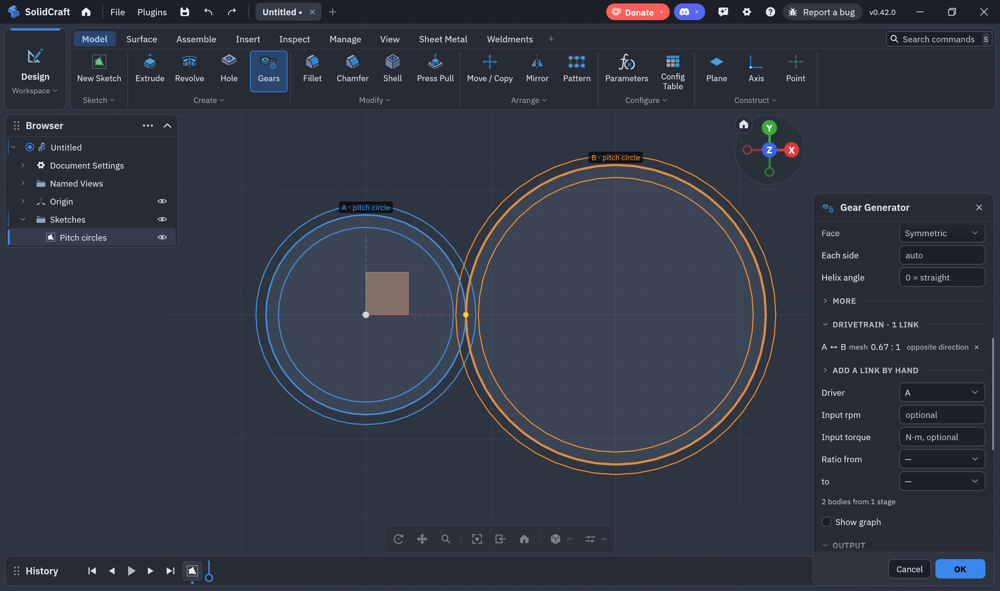<br/><sub>Two circles picked, the mesh accepted: 0.67 : 1</sub></td></tr>
<tr><td align="center"><br/><sub>A compound: a shaft line and a circle in each of two layers</sub></td><td align="center"><br/><sub>Edit reopens the set with every gear's card</sub></td></tr>
<tr><td align="center"><br/><sub>A deleted reference is named, not guessed</sub></td><td align="center"><br/><sub>Built: bodies, joints and a gear link in one feature</sub></td></tr>
</table>

Ten example designs, from a spur pair to a mixed drivetrain, are in
[examples/gears/](examples/gears/README.md).

### What the Gears dialog makes

| Shafts | Types in the dialog |
|---|---|
| Parallel | spur, helical, herringbone (each per gear: helix angle, hand, V teeth), ring gear with its pinion, rack and pinion, compound (two or more gears on one shaft, one body), planetary (sun, ring, planets and a generated carrier) |
| Intersecting | bevel pair: straight, spiral or chevron, any shaft angle |
| Crossed | hypoid pair, worm and wheel, crossed helical |
| — | shaft (a shaft line with bearing points, no teeth) |

**Not in the dialog.** The gear engine also makes chain sprockets, timing pulleys, cycloidal
gears, a cycloidal drive, involute splines, elliptical pairs, face gears, bevel planetary sets and
complete differentials. These were reachable from the earlier Gear Generator window, which this
branch replaced. In this build they can only be made with the `gear.create` command (CLI, scripts,
MCP), not from the Gears dialog. Sets made with the earlier window open as they are and keep
following their sketch.

## How it works

### Teeth are generated, not drawn from tables

- **Involute teeth** are the envelope of a basic rack (ISO 53 profiles A–D, AGMA full depth, stub,
  a 3D-print rack, or custom addendum, dedendum and root radius) rolled along the pitch circle.
  That gives the true trochoid root fillet, undercut where it really happens, profile shift, tip
  shortening and the working pressure angle. By default the flanks are fitted to splines within a
  set tolerance. Each set reports its centre distance,
  contact ratio, span and over-pins measurements.
- **Bevel teeth** are octoids: cut by a crown gear, so they are conjugate along the whole face. That
  holds for straight teeth and for spiral teeth on a logarithmic spiral, at any shaft angle. The
  teeth end on the back (heel) and front (toe) cones, square to the pitch cone, so a nearly flat
  cone (the larger gear at a 100° to 150° shaft angle) is built as correctly as a steep one.
- **Hypoid pitch cones** are worked out in the terms of ISO 23509: the wheel pitch angle is found by
  iteration with the Method 1 curvature condition, and the result reproduces a published ISO 23509
  Method 1 set. Tooth depths are Gleason's. The ring gear has straight-sided teeth on a
  logarithmic spiral, and the pinion is generated from the ring gear. Both are trimmed at toe and
  heel, and the pinion has its own face width and offset. An offset too large for the sizes is refused, and the
  message gives the largest offset that still works.
- **Worm wheels** are throated and hobbed: the hob is the worm's own thread, made taller by the root
  clearance. Each section through the face is what the thread leaves as it turns.
- **Other teeth** (command only, see above): sprockets follow ISO 606 (its A series is ANSI B29.1),
  and splines follow DIN 5480 or ANSI B92.1. Timing-pulley grooves are approximations from
  published belt dimensions (GT2 and HTD are proprietary profiles). Cycloidal gears have epicycloid
  addenda and hypocycloid dedenda, and the cycloidal drive's disc is an offset epitrochoid. A face
  gear is cut by its spur pinion.
- **Strength:** ISO 6336 Method B (simplified) gives the tooth-root and flank safety factors SF and
  SH of cylindrical gears for a given torque or power. Bevels get a simplified rating on their
  virtual cylindrical gears (in the style of ISO 10300), and worm sets an approximate one.

### From sketch to drivetrain

The gear math is a dependency-free crate (`crates/gear`).

1. **Items.** The dialog sends one item per gear card: its type, the sketch entities it picked (by
   sketch and id), and each gear's settings; plus the links, module blocks and driver
   (`gear.create` with `items`). The engine (`crates/engine/src/cmd/gear_items.rs`) reads each
   entity where it is now and refuses one that is gone, naming it.
2. **Stages.** `items::stages` splits the drivetrain into stages: trains of gears on parallel
   shafts, planetary sets, racks, and bevel, hypoid, worm and crossed-helical pairs, joined by
   shared shafts. `plan::system::plan_items` sizes each stage (`sketch_rules`: the drawn diameters
   kept, one module per meshing group, profile shift for the drawn centre distances), plans it with
   its own planner, places it where the drawing puts it, checks that stages don't sweep into each
   other, and merges everything into one `Plan` with one assembly.
3. **Plan.** `plan(spec)` gives each body as a frame plus a list of solid steps (`Prism` for spur
   and helical teeth, `Taper` for bevel teeth, `Loft` for worm wheels and hypoids, `Revolve`,
   `Coil` for a worm's thread, `Placed`; each `New`, `Join`, `Cut` or `Intersect`), with facts,
   warnings, or a refusal that says what to change.
4. **Build.** `crates/engine/src/cmd/gear_feature.rs` stores the request as one native **Gears
   feature** (`FeatureKind::Gears`) holding the sketches it reads. The document evaluates it like any
   other feature (`crates/doc/src/eval_gears.rs`): it reads the sketches again, plans the set and
   builds every body, so a sketch edit recomputes it in place. Bodies are named by item and gear
   (`Gear A·1`, `Gear B·1+2`), so they keep their names, components and joints through edits.
   `gear_assembly.rs` makes the components, revolute joints and gear links.

Lofts are checked before the kernel sees them. The kernel restarts each section at the segment that
best lines up with the previous section, so a steep spiral or worm section turned too far would be
matched a few segments off, and the walls would cut across the teeth. The planner repeats that
alignment rule and adds sections until none slips. It also stays inside the kernel's limit of 16,384
curves per loft (all sections together, counting every spline span).

### Checked, not assumed

- **Every pick is checked** as you click it: a circle tilted to its shaft, a pinion not touching
  its ring, a worm line inside the wheel. The refusal says what is wrong and what to do.
- **2D mesh checker:** parallel-axis sets are turned through a tooth pitch. The checker flags
  overlap deeper than 0.003 × module, or flanks further apart than the backlash plus 0.006 × module.
- **3D mesh checker:** straight bevel, spiral bevel, hypoid, crossed helical and worm sets are
  sampled from the planned solids over the motion and checked against the same limits.
- **Kernel check:** sets are built through the real kernel and checked with `inspect.interference`
  for no overlap or only flank contact. On spiral bevel, hypoid and some pairs the kernel's own
  check fails; the gear crate's mesh checker covers those (see the known issues).

### Scriptable

`gear.create`, `gear.calculate` (works out the set without building), `gear.update` and `gear.ratio`
are normal SolidCraft commands, so the same drivetrain can be made from the CLI, from scripts and
through the MCP server. See [docs/gears/scripting.md](docs/gears/scripting.md); every example in
[examples/gears/](examples/gears/README.md) has its script in `examples/gears/scripts/`:

```sh
cargo build --release -p solidcraft-cli
target/release/solidcraft-cli run examples/gears/scripts/01-spur-pair.json --save 01-spur-pair.sc --results
```

### Code map

| Path | |
|---|---|
| `crates/gear/src/items.rs` | gear items: slots, pick checks, suggested links, stages |
| `crates/gear/src/plan/system.rs` | a whole drivetrain of items planned and merged into one plan |
| `crates/gear/src/plan.rs`, `plan/` | `Spec`, `Plan`, every type's planner, assemblies (`plan/assembly.rs`) |
| `involute.rs`, `octoid.rs`, `hypoid.rs`, `worm.rs`, `cycloid.rs` | tooth generation |
| `sketch_rules.rs`, `drivetrain.rs`, `axes.rs` | sizing from drawn diameters, reading circles and lines, placing sets on shafts |
| `mesh2d.rs`, `mesh3d.rs` | the mesh checkers |
| `clearance.rs`, `hub.rs`, `body.rs`, `strength.rs` | housing cutout and bearing seats, bores and hubs, shafts and print tuning, strength (ISO 6336) |
| `crates/engine/src/cmd/gear_items.rs`, `gear_feature.rs` | reading items from the sketches, the Gears feature, body names, `gear.ratio` |
| `crates/engine/src/cmd/gear.rs`, `gear_assembly.rs`, `schema/gear.rs` | the commands, components and joints, the parameter schema |
| `crates/doc/src/eval_gears.rs` | evaluating a Gears feature in the timeline |
| `crates/ui-egui/src/dialogs_gear*.rs` | the Gears dialog: cards, settings, drivetrain links, graph, preview |

Build: `cargo run --release -p solidcraft`. Tests: `cargo test --release -p solidcraft-gear` (the
math) and `cargo test --release -p solidcraft-engine --lib gear` (building through the kernel).

**Known issues:** see [examples/gears/README.md](examples/gears/README.md#known-issues) and
[GEAR_GENERATOR.md](GEAR_GENERATOR.md#status-and-known-issues) (the earlier window's notes).

---

<p align="center">
  
</p>

<h1 align="center">SolidCraft</h1>

<p align="center">
  <strong>An open-source parametric 3D CAD application built in pure Rust.</strong><br />
  Sketch, constrain, and build solids with a parametric feature timeline. Change a dimension
  and watch your model rebuild. Run it on your desktop, in your browser, or let AI agents
  model through the built-in MCP server.
</p>

<div align="center">

[![Download for Windows][badge-windows]][windows-msi]
[![Download for macOS][badge-macos]][macos-dmg]
[![Download for Linux][badge-linux]][linux-appimage]
[![Get it from the Snap Store][badge-snap]][snap-store]
[![Try it in your browser][badge-web]][web-app]

</div>

<p align="center">
  <a href="https://solidcraft.io">Website</a> ·
  <a href="https://solidcraft.io/download">Download</a> ·
  <a href="https://solidcraft.io/app">Try it in the browser</a> ·
  <a href="https://docs.solidcraft.io/">Documentation</a> ·
  <a href="https://www.blacksmith.sh"></a>
  <a href="https://discord.gg/FtU4NQNVDH">Discord</a> ·
  <a href="https://github.com/tangency-labs/solidcore">SolidCore</a>
</p>

<p align="center">
  <a href="https://github.com/tangency-labs/solidcraft/actions/workflows/ci.yml?query=branch%3Amain"></a>
  <a href="https://github.com/tangency-labs/solidcraft/releases/latest"></a>
  <a href="https://github.com/tangency-labs/solidcraft/releases"></a>
  <a href="LICENSE"></a>
  <a href="https://discord.gg/FtU4NQNVDH"></a>
  <a href="https://remade.wiki/projects/solidcraft/"></a>
  <a href="https://github.com/tangency-labs/solidcraft/stargazers"></a>
</p>

<p align="center">
  <a href="https://trendshift.io/repositories/296178?utm_source=trendshift-badge&utm_medium=badge&utm_campaign=badge-trendshift-296178" target="_blank" rel="noopener noreferrer"></a>
  <a href="https://trendshift.io/repositories/296178?utm_source=trendshift-badge&utm_medium=badge&utm_campaign=badge-trendshift-296178" target="_blank" rel="noopener noreferrer"></a>
</p>


*A Raspberry Pi 4 case from an empty design: a sketch dimensioned with the board's parameters, extrude, fillet, shell, the rim rounded in one pick, an M2.5 standoff patterned on the 58 × 49 mm hole rectangle, port cut-outs, vent slots, "Pi 4" engraved in DejaVu Sans Bold and a PETG material defined in the design, with its mass in Properties, then height 24 → 32 mm in Parameters and it all rebuilds. 6× playback with the idle pauses cut. [Full video](https://github.com/tangency-labs/solidcraft/raw/refs/heads/main/docs/screenshots/demo.mp4), recorded with the [demo script](examples/demo/record_ui.sh).*

## Download

- **Windows:** the [installer][windows-msi].
- **macOS:** the [disk image][macos-dmg] (Apple silicon and Intel).
- **Linux:** the [AppImage][linux-appimage], or `sudo snap install solidcraft` ([Snap Store][snap-store]).
- **Web:** [try it in your browser][web-app], no install.

ARM64 and 32-bit builds, portable zip, .deb, .rpm, Flatpak and the other packages are on the
[downloads page](docs/downloads.md). The macOS app is signed with a Developer ID and notarized by
Apple. Windows signing: free code signing provided by SignPath.io, certificate by SignPath
Foundation ([code signing policy](https://docs.solidcraft.io/code-signing-policy.html)). Until the
production certificate is in place, SmartScreen may warn: choose **More info**, then **Run anyway**. On SolidCraft 0.11 to 0.14, download once by hand; see
[updating](https://docs.solidcraft.io/guide/updates.html#updating-from-011-to-014).

## What works

Early but usable for simple parts: 75 of 76 public reference parts match their analytic or
FreeCAD-computed volume, area, centre of mass and bounding box ([oracle](docs/oracle.md)); the
other is a tracked bug.

- **Sketches and constraints:** lines, arcs, splines, text and more, solved by our own constraint solver, with parameter-driven dimensions.
- **Features:** extrude, revolve, sweep, loft, fillet, chamfer, shell, draft, holes, threads, patterns, mirror, split and combine on an editable parametric timeline.
- **Parameters and configurations** with unit-aware expressions.
- **Assemblies** with joints, motion studies, contact sets, interference and mass properties.
- **Sheet metal** with flanges, hems, fold/unfold and flat patterns, and plastic enclosure features.
- **Files:** STEP, IGES, 3MF, STL, OBJ and glTF in and out where supported, URDF export, `.sc` designs (`.solidcraft` files from earlier releases still open).
- **Desktop app, browser app, headless CLI and MCP server**, all running the same commands.

The full list is in [docs/capabilities.md](docs/capabilities.md) and [docs/features.md](docs/features.md);
status and plans are in [ROADMAP.md](ROADMAP.md). See also [what people built](docs/showcase.md),
[3D mouse support](docs/3d-mouse.md) and the [architecture](docs/architecture.md).

## Build from source

```sh
cargo run --release -p solidcraft -- --sample      # desktop app with a sample part
cargo run --release -p solidcraft-cli -- commands  # the command registry
cargo run --release -p solidcraft-cli -- run examples/bracket.json --out bracket.step
cargo xtask ci                                     # fmt, clippy, tests, icons, assets, layers, wasm
```

More commands, the Windows cross-build and the browser build are in [docs/building.md](docs/building.md).

## AI agents (MCP)

`solidcraft-cli mcp` is a [Model Context Protocol](https://modelcontextprotocol.io) server. Headless it
runs its own design session, or with `--connect` it drives the running app so you can watch.
Claude Code: `claude mcp add solidcraft -- solidcraft-cli mcp`. If a terminal doesn't find
`solidcraft-cli` (older Windows installers don't put it on `PATH`), give its full path (by default
`"C:\\Program Files\\SolidCraft\\solidcraft-cli.exe"`). Tools, access rules and an example session:
[docs/mcp.md](docs/mcp.md).

## Scripts

A script is a JSON list of the same commands the UI runs, executed with `solidcraft-cli run`.
Format and example: [docs/scripts.md](docs/scripts.md). Pages can also be driven through the
[browser command API](docs/browser-api.md).

## Plugins (experimental desktop runtime)

Plugins add separately distributed behaviour without compiling that behaviour into SolidCraft.
The initial runtime loads **WebAssembly components**, explicitly requested by the user. Merely
installing a folder, enabling it in Preferences, or opening a design never executes plugin code.
The interface is experimental: WIT package `craft:plugin@0.1.0`, capability `commands@0.1`. While
it is 0.x a minor version may break the one before it; the host refuses a plugin that needs a
capability it does not have, in plain words. Review a plugin again after an update. The desktop app and headless CLI use the same commands. Browser
execution, automatic downloads and updates, custom panels, and plugin-defined parametric feature
types are future work.

### Install and inspect

A package is a folder named after its id, containing `plugin.json` and a `.wasm` component.
Preferences > Plugins lists packages under the per-user data folder: `%LOCALAPPDATA%/SolidCraft/plugins`
on Windows, `~/Library/Application Support/SolidCraft/plugins` on macOS, and
`${XDG_DATA_HOME:-~/.local/share}/solidcraft/plugins` on Linux. **Show in folder** opens this location.
You can also inspect and explicitly run a package in another folder. Nothing is downloaded by the host.

A minimal manifest looks like this. Plugin packages and examples are maintained outside this
repository, as specified in [the plugin RFC](docs/rfcs/0002-plugins.md).

```json
{
  "id": "example-box",
  "name": "Example box",
  "version": "0.1.0",
  "description": "Create an ordinary editable box from dimensions.",
  "capabilities": ["commands@0.1"],
  "runtime": {
    "module": "plugin.wasm",
    "entries": ["make"],
    "commands": ["solid.box"],
    "limits": {"fuel": 10000000, "memory_mib": 64, "deadline_ms": 5000}
  }
}
```

Run `plugin.inspect` with `{"path":"/path/to/example-box"}` through the CLI's JSON scripts, MCP
`execute`, or the desktop control channel's `engine.execute`. It reads the manifest and component
without executing them, returning the declared commands, limits and an `approval` SHA-256 hash.
Review the author, code and declared rights before using that hash. Inspection does not approve a
package. Existing metadata-only packages remain listable but cannot run until they declare a runtime.

### Run explicitly

After reviewing the inspected package, execute:

```json
{
  "command": "plugin.run",
  "params": {
    "path": "/path/to/example-box",
    "approval": "<exact approval hash returned by plugin.inspect>",
    "entry": "make",
    "params": {"length": 20, "width": 10, "height": 3}
  }
}
```

For example, save that command in a JSON array and use `solidcraft-cli run commands.json`.
For the running desktop app, send it as the `command` and `params` of a standalone
`engine.execute` request (see [control protocol](docs/control-protocol.md)). The native host runs
it on a worker and keeps the window responsive. Stop or a design change discards the pending
result; the host does not automatically rerun external code. Desktop batches and scripts must send
`plugin.run` separately. Headless CLI scripts may include it as a normal command.

The hash binds **both the exact manifest bytes and the component bytes**, so an updated package
requires a fresh inspection and permission review. It is a content identity, not a signature or an
author's reputation. Agent chat asks before executing external plugin code. MCP and the control
channel keep their existing file scopes: allow the package folder explicitly where needed. Naming
a package never grants access to another folder.

### User resource ceilings

The invocation defaults remain **10,000,000 fuel, 64 MiB of guest memory and 5000 ms**.
The default host ceilings remain **100,000,000,000 fuel and 128 MiB**. A package can declare
larger fuel or memory budgets, but execution is refused until you explicitly raise the host
ceilings and approve that exact package content. `plugin.inspect` is inert and reports the
requested limits, current `host_limits`, `within_host_limits` and any `limits_error` even when
a request is too large.

In the native GUI, open **Preferences > Plugins**, enter **Max plugin fuel** and
**Max plugin memory (MiB)**, then choose **Apply** or **OK**. Enter also accepts both values;
**Cancel** reverts changes since the last Apply and **Restore defaults** resets this page.
The settings persist in your user preferences and do not travel with saved designs.

For standalone CLI or headless MCP sessions, create a UTF-8 JSON file, for example
`plugin-limits.json` containing:

```json
{"max_fuel": 200000000000, "max_memory_mib": 512}
```

Pass it explicitly when starting the process:

```text
solidcraft-cli --plugin-limits plugin-limits.json run inspect-plugin.json --results
solidcraft-cli --plugin-limits plugin-limits.json mcp --headless --allow-path /path/to/plugins
```

Missing fields use the original host ceilings. Connected desktop sessions use the GUI's
preferences; CLI settings cannot override them. Positive integer fuel values up to `u64::MAX`
are accepted without rounding. Guest memory is limited to 4096 MiB by the current Wasm32 ABI;
that technical boundary requires a different runtime ABI to change. Neither setting changes
a package's declared budget, executes it, adds permissions, or retries a failed invocation.
Review its manifest and component, obtain the content approval hash, and explicitly invoke it.
A changed manifest budget requires a fresh approval hash. Keep the selected ceilings within your
machine's available resources; they are limits on guest execution, not total SolidCraft memory
or native CAD work. The independent maximum execution deadline stays 30 seconds.

### Permissions, results and saved designs

A plugin can call any command in the MCP catalog whose exact id its manifest lists. Commands that
reach past the open design are grouped: `file` (saving, exporting, importing, inserting from files,
libraries), `doc` (opening or switching designs), `app` (settings, window, diagnostics) and `plugin`
(inspecting or running plugins). Each group is refused unless the manifest requests it in
`runtime.permissions.command_groups` and the user grants it; this version has no grant UI yet.
Filesystem calls require matching manifest permissions and approved folder grants. The clock
requires its manifest permission; otherwise it returns a fixed epoch. No WASI, socket or process
API is linked. A design container reserves `plugins/<plugin-id>/` for a plugin's own data, kept
and saved back untouched when the plugin is missing; plugins cannot read or write it until the
`storage` capability arrives.
Inspection commands can disclose model data, so review them as permissions too. In particular, the optional
`model.mesh` permission exposes the requested body's evaluated vertices and triangles in its owning
component's coordinates (millimetres), with explicit transfer limits. It performs no conversion.

Edits run against an isolated copy of the design. Only a successful call is adopted, as **one Undo
step**. A trap, exhausted fuel, memory limit, invalid result or refused host call discards the
transaction, preserving the previous design and undo/redo history. The host validates produced
native features before accepting them. A plugin that catches a refused host call cannot commit an
earlier partial edit. CPU-heavy guest loops are bounded by fuel and a deadline; the guide explains
the separate cost of compiling a component and executing a granted native command.

The result is ordinary native features: they save, undo, redo and rebuild without the plugin.
Removing the package disables future invocations; it does not remove the features already created.
Changing the plugin's own parameters means another invocation in this first version; there is no
plugin-owned timeline evaluation hook yet. Turn an installed plugin off in Preferences > Plugins
to refuse subsequent desktop calls. Disabling it or changing resource ceilings during a pending
call prevents adoption. CLI
processes have their own session policy and do not read the desktop app's preferences.

See the [runtime and author guide](docs/plugin-runtime.md) for the complete manifest, supported
command boundary, limits, build options, tests and current restrictions.
For step-by-step package checks and expected results, see the [English test guide](docs/plugin-test-guide.md). The existing
[parametric plugin design](docs/plugins.md) remains a separate future phase.

## Contributing

Help is welcome. [CONTRIBUTING.md](CONTRIBUTING.md) covers how to build and test, the code map,
the clean-room and licence rules, and where help is wanted most. Open work is in
[GitHub issues](https://github.com/tangency-labs/solidcraft/issues); chat is on
[Discord](https://discord.gg/FtU4NQNVDH).

## Sponsors

[](https://www.blacksmith.sh)

SolidCraft's continuous integration runs on [Blacksmith](https://www.blacksmith.sh), which
sponsors its CI minutes.

## Disclaimer

The files in this repository are provided as is, without warranty, liability or indemnity, and
Tangency Labs and the contributors accept no responsibility for any harmful or unlawful use of
them: read [DISCLAIMER.md](DISCLAIMER.md).

## Licence

MIT OR Apache-2.0, at your option. Developed under the
[clean-room contribution rules](AGENTS.md); third-party code and assets retain their
documented licences and attribution.

SolidCraft's brand and interface are licensed separately, under
[LICENSE-BRAND](LICENSE-BRAND): the UI kit, the look (interface icons, glyphs, built-in themes),
the theme's design tokens and palettes, and the SolidCraft name, logo and app icon. Use them freely
as part of SolidCraft. Using them in another program or product needs the maintainers' written
permission first.

SolidCraft is independent. Behaviour is designed from public documentation, general CAD
conventions and user feedback. Reference tests use analytic values and open-source tools.
SolidCraft is not affiliated with, sponsored by or endorsed by Autodesk, Dassault Systèmes, PTC,
Siemens or any other CAD vendor. Fusion, AutoCAD, Inventor, SolidWorks, Onshape, Creo, Blender and
Tinkercad are trademarks of their respective owners, named only to describe compatibility
(see [NOTICE](NOTICE)).

[badge-windows]: https://img.shields.io/badge/Windows-Download-0078D6?style=for-the-badge&logo=data%3Aimage%2Fsvg%2Bxml%3Bbase64%2CPHN2ZyB4bWxucz0iaHR0cDovL3d3dy53My5vcmcvMjAwMC9zdmciIHZpZXdCb3g9IjAgMCAyNCAyNCIgZmlsbD0id2hpdGUiPjxwYXRoIGQ9Ik0yIDJoOS41djkuNUgyek0xMi41IDJIMjJ2OS41aC05LjV6TTIgMTIuNWg5LjVWMjJIMnpNMTIuNSAxMi41SDIyVjIyaC05LjV6Ii8%2BPC9zdmc%2B
[badge-macos]: https://img.shields.io/badge/macOS-Download-333333?style=for-the-badge&logo=apple&logoColor=white
[badge-linux]: https://img.shields.io/badge/Linux-AppImage-E95420?style=for-the-badge&logo=linux&logoColor=white
[badge-snap]: https://img.shields.io/badge/Snap-Snap_Store-82BEA0?style=for-the-badge&logo=snapcraft&logoColor=white
[badge-web]: https://img.shields.io/badge/Web-Try_in_browser-2EA44F?style=for-the-badge&logo=data%3Aimage%2Fsvg%2Bxml%3Bbase64%2CPHN2ZyB4bWxucz0iaHR0cDovL3d3dy53My5vcmcvMjAwMC9zdmciIHZpZXdCb3g9IjAgMCAyNCAyNCIgZmlsbD0ibm9uZSIgc3Ryb2tlPSJ3aGl0ZSIgc3Ryb2tlLXdpZHRoPSIyIj48Y2lyY2xlIGN4PSIxMiIgY3k9IjEyIiByPSIxMCIvPjxwYXRoIGQ9Ik0yIDEyaDIwTTEyIDJhMTUgMTUgMCAwIDEgMCAyME0xMiAyYTE1IDE1IDAgMCAwIDAgMjAiLz48L3N2Zz4%3D
[windows-msi]: https://github.com/tangency-labs/solidcraft/releases/latest/download/solidcraft-windows-x64.msi
[macos-dmg]: https://github.com/tangency-labs/solidcraft/releases/latest/download/solidcraft-macos-universal.dmg
[linux-appimage]: https://github.com/tangency-labs/solidcraft/releases/latest/download/solidcraft-linux-x86_64.AppImage
[snap-store]: https://snapcraft.io/solidcraft
[web-app]: https://solidcraft.io/app

