> [!NOTE]
> **This is a fork of [tangency-labs/solidcraft](https://github.com/tangency-labs/solidcraft) with a built-in Gear Generator.**
> The upstream SolidCraft README follows below the line. Hands-on guide: [GEAR_GENERATOR.md](GEAR_GENERATOR.md).
> Work in progress, shared for testing: issues and pull requests are welcome here.

# Gear Generator for SolidCraft

A gear generator that is part of the app, not a plugin. **Model › Create › Gears** opens a window where
you lay out the shafts, see the set mesh in 2D and 3D as you type, and build solid gears into the
parametric timeline. It covers parallel, intersecting and crossed shafts, from a spur gear to a
hypoid final drive, a multi-start worm or a bevel differential.

<p align="center"></p>

<table align="center">
<tr><td align="center"><br/><sub>Spur</sub></td><td align="center"><br/><sub>Helical</sub></td><td align="center"><br/><sub>Herringbone</sub></td><td align="center"><br/><sub>Internal</sub></td><td align="center"><br/><sub>Rack</sub></td><td align="center"><br/><sub>Pair</sub></td><td align="center"><br/><sub>Planetary</sub></td><td align="center"><br/><sub>Bevel</sub></td><td align="center"><br/><sub>Spiral bevel</sub></td><td align="center"><br/><sub>Face</sub></td></tr>
<tr><td align="center"><br/><sub>Bevel planetary</sub></td><td align="center"><br/><sub>Hypoid</sub></td><td align="center"><br/><sub>Crossed helical</sub></td><td align="center"><br/><sub>Worm</sub></td><td align="center"><br/><sub>Cycloidal</sub></td><td align="center"><br/><sub>Cycloidal drive</sub></td><td align="center"><br/><sub>Sprocket</sub></td><td align="center"><br/><sub>Pulley</sub></td><td align="center"><br/><sub>Spline</sub></td><td align="center"><br/><sub>Elliptical</sub></td></tr>
</table>

### It runs live while you design

Every set turns in the window's preview as you edit it, drawn from the gear math in milliseconds
(these are screen captures of that preview, not kernel renders):

<table align="center">
<tr><td align="center">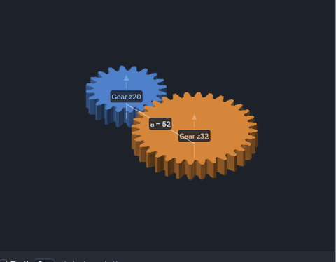<br/><sub>Gear pair</sub></td><td align="center">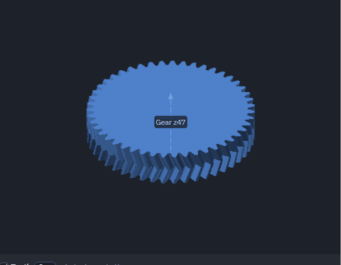<br/><sub>Helical</sub></td><td align="center">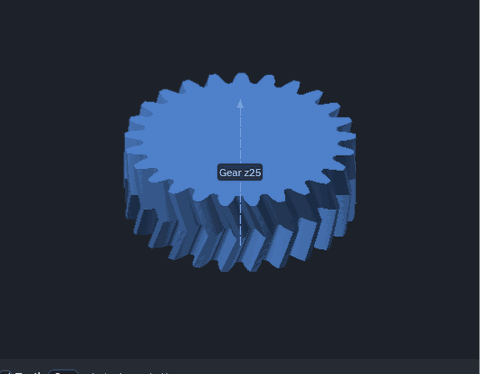<br/><sub>Herringbone</sub></td></tr>
<tr><td align="center"><br/><sub>Internal ring</sub></td><td align="center"><br/><sub>Planetary</sub></td><td align="center">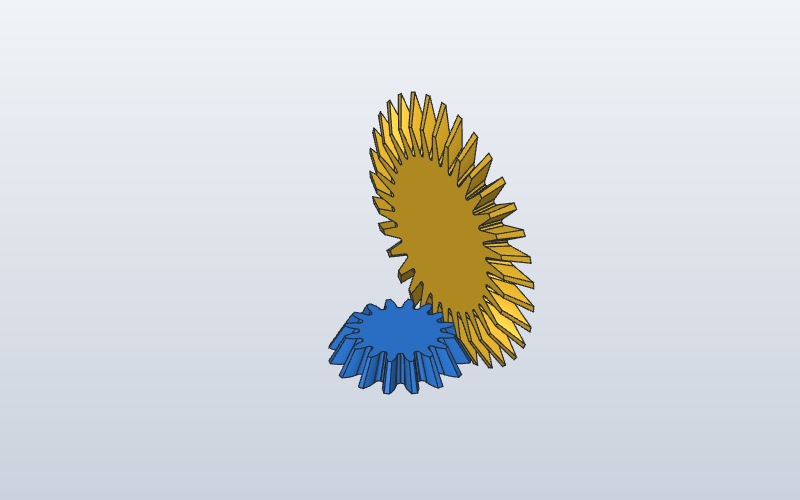<br/><sub>Straight bevel</sub></td></tr>
<tr><td align="center">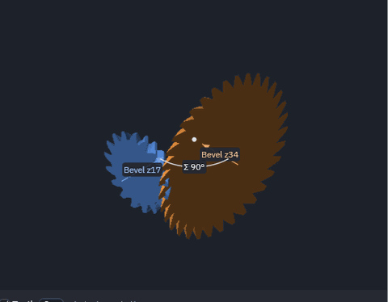<br/><sub>Spiral bevel</sub></td><td align="center">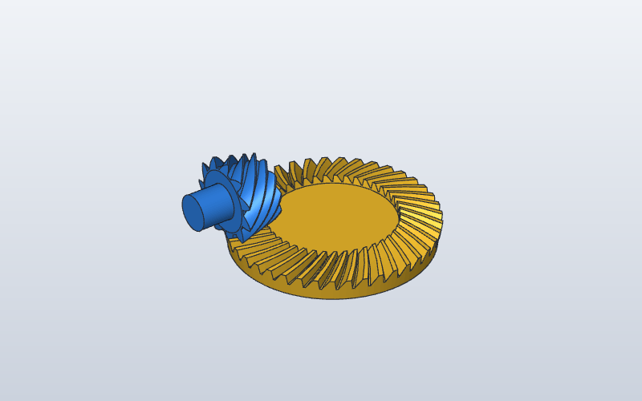<br/><sub>Hypoid</sub></td><td align="center"><br/><sub>Crossed helical</sub></td></tr>
<tr><td align="center">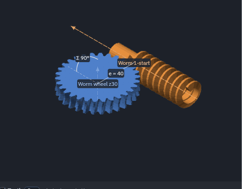<br/><sub>Worm and wheel</sub></td><td align="center">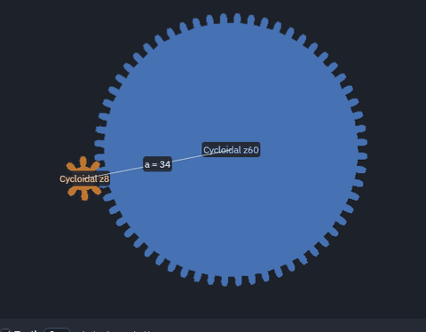<br/><sub>Cycloidal</sub></td></tr>
</table>

### Designed from one small drawing

Simple mode: circles are pitch circles, lines are shafts, a dot is the origin (a bevel's apex); the
type picker, the editable drawing, the turning 3D preview and the numbers the solver chose:

<table align="center">
<tr><td align="center">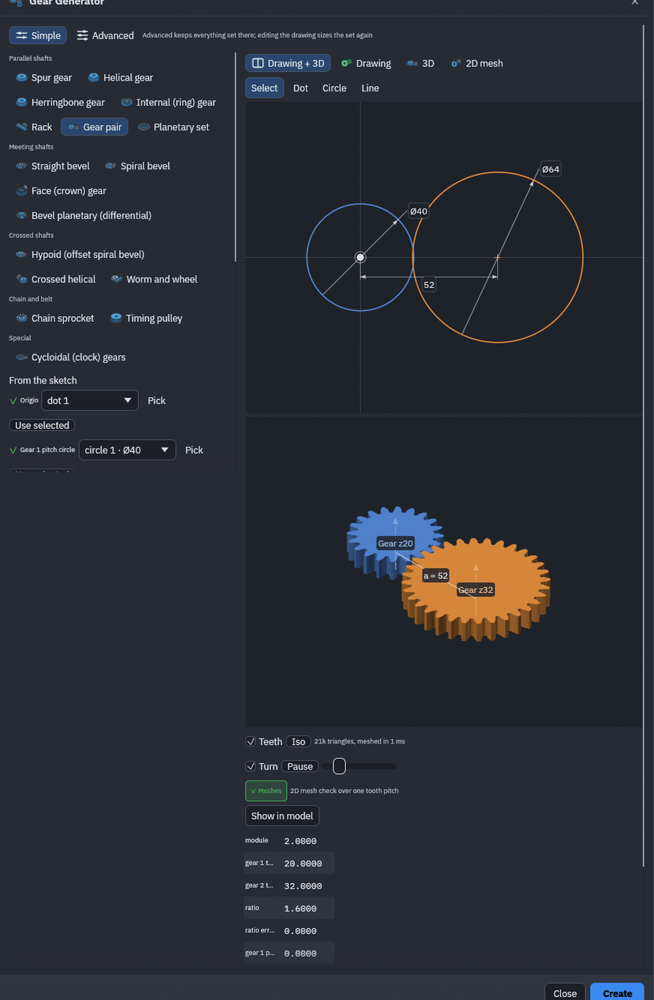<br/><sub>Gear pair: two pitch circles</sub></td><td align="center">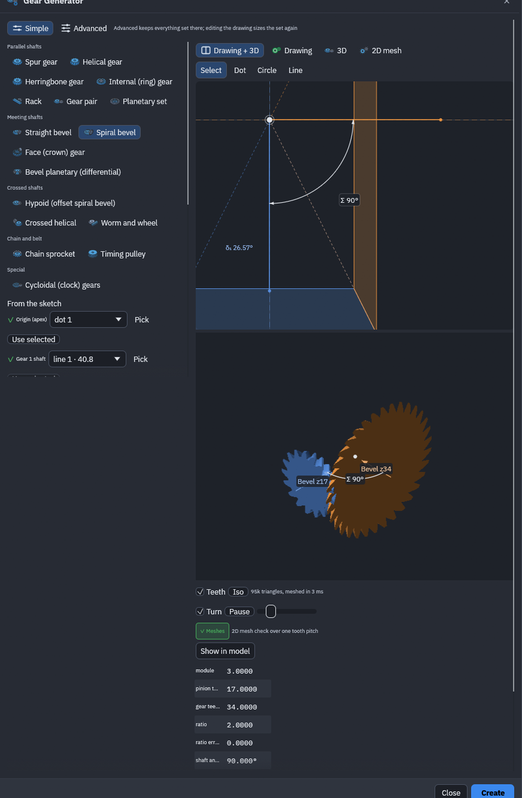<br/><sub>Spiral bevel: side view, apex dot and 90° meeting angle</sub></td></tr>
<tr><td align="center">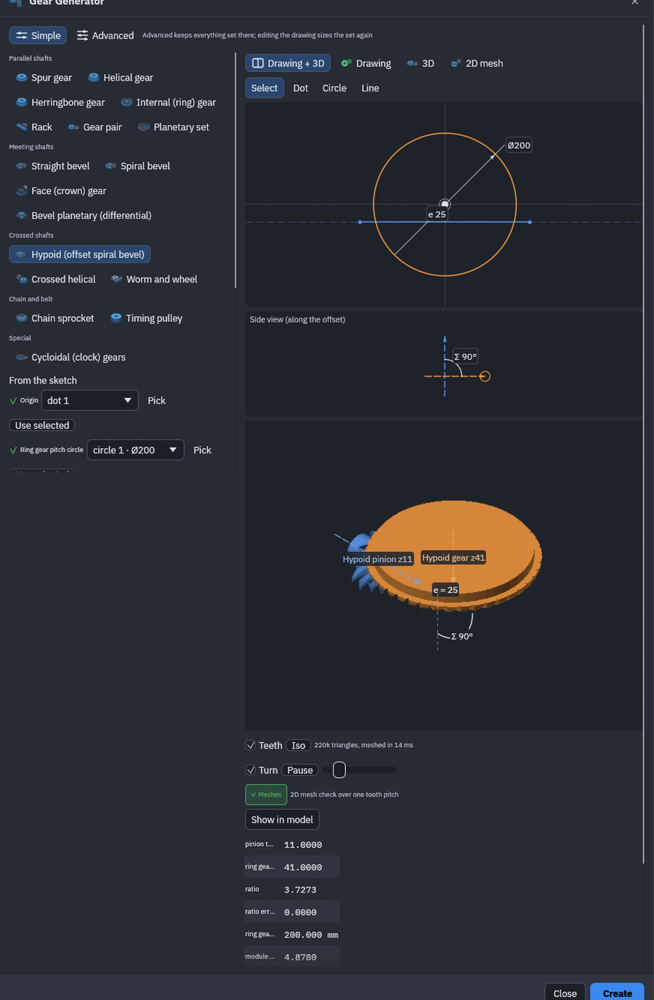<br/><sub>Hypoid: ring circle, pinion shaft offset</sub></td><td align="center">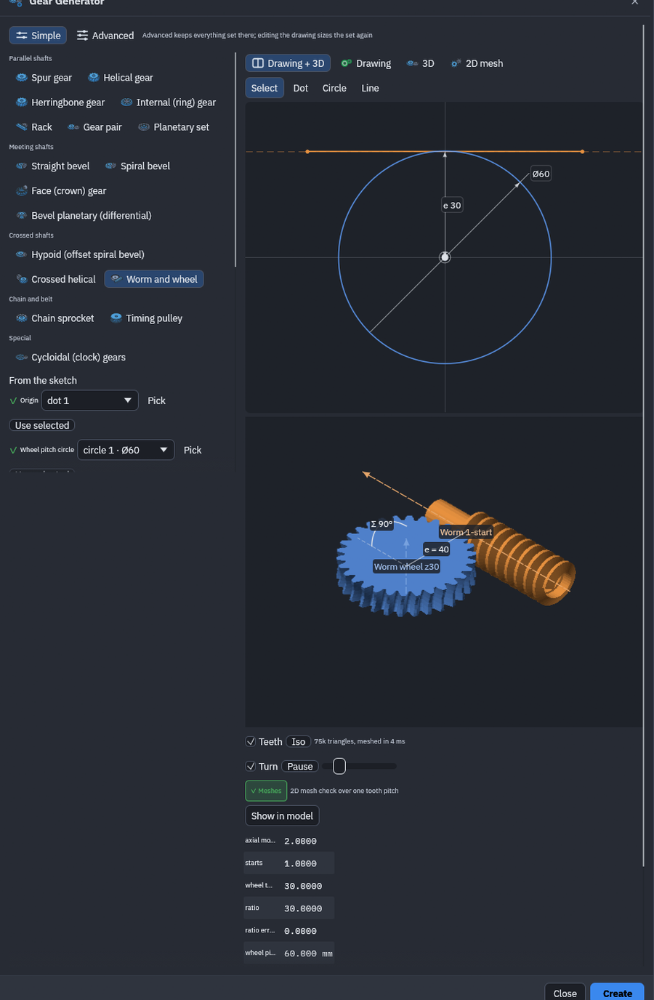<br/><sub>Worm: wheel circle and tangent worm line</sub></td></tr>
</table>

| Shafts | Types |
|---|---|
| Parallel | spur, helical, herringbone, internal ring, rack, pair, planetary |
| Intersecting (any angle) | straight bevel, spiral bevel, face (crown) gear, bevel planetary (differential, single, or with an internal bevel ring) |
| Crossed | hypoid, crossed helical, worm and throated wheel (1–4 starts) |
| Wrapped | ISO 606 / ANSI roller-chain sprockets, timing pulleys (GT2, HTD, T, MXL, XL) and the chain or belt between them |
| Special | cycloidal clock gears, cycloidal drive, DIN 5480 / ANSI B92.1 splines, elliptical pairs |

## How it works

### Teeth are generated, not drawn from tables

- **Involute teeth** are the envelope of a basic rack (ISO 53 profiles A–D, or custom addendum,
  dedendum and root radius) rolled along the pitch circle. That gives the true trochoid root fillet,
  undercut where it really happens, profile shift, tip shortening and the working pressure angle.
  The flanks are fitted to splines within a set tolerance. Each set reports its centre distance,
  contact ratio, span and over-pins measurements.
- **Bevel teeth** are octoids: cut by a crown gear, so they are conjugate along the whole face. That
  holds for straight teeth and for spiral teeth on a logarithmic spiral, at any shaft angle.
- **Hypoid sets** follow ISO 23509 Method 1 (Gleason's calculation, as in Litvin & Fuentes). The pitch
  cones are found by iteration, the ring gear has logarithmic-spiral teeth, and the pinion is
  generated from the ring gear. An offset too large for the sizes is refused, with the largest offset
  that still works.
- **Worm wheels** are throated and hobbed by the worm itself: each section through the face is cut by
  the thread as it turns.
- **Cycloidal, sprocket, pulley, spline and face-gear** teeth come from their own standards (ISO 606,
  DIN 5480 and so on). A face gear is cut by its spur pinion.
- **Strength:** ISO 6336 Method B (simplified) gives the tooth-root and flank safety factors SF and
  SH for a given torque or power, with simplified versions for bevels and worms.

### Plan, then build

The gear math is a dependency-free crate (`crates/gear`). `plan(spec)` turns a `Spec` (type, teeth,
module, angles, bores, shafts…) into a `Plan`:

- **bodies**, each a frame plus a list of solid steps:
  - `Prism`: an extrude, or a sweep with a twist for helical teeth;
  - `Taper`: a loft or sweep towards the cone apex, for bevels;
  - `RingTaper`: a bevel ring in one loft;
  - `Loft`: through hobbed or generated sections;
  - `Revolve` and `Coil`, plus `Placed` for members set at an angle;
  - each step is `New`, `Join`, `Cut` or `Intersect`;
- facts, warnings, a refusal when the set can't be made, and the 2D and 3D previews.

The engine (`crates/engine/src/cmd/gear.rs`) maps each step 1:1 onto ordinary SolidCraft sketches and
features. The whole set is one undo step and one timeline group. A set is built with the kernel's
full face-by-face check off, because for gear teeth that check costs as much as building them. It
runs again the next time the features are computed.

Lofts are checked before the kernel sees them. The kernel restarts each section at the segment that
best lines up with the previous section, so a steep spiral or worm section turned too far would be
matched a few segments off, and the walls would cut across the teeth. The planner repeats that
alignment rule and adds sections until none slips. It also stays inside the kernel's limit of 16,384
curves per loft, counting every spline span. Big multi-start worm wheels draw each tooth side with
fewer points when they need to.

### Fast to design with

- **Simple mode** designs by what you need. You draw circles (pitch circles), lines (shafts) and a dot
  (the origin, or a bevel's apex) in one small sketch. The solver picks standard ISO 54 modules,
  whole tooth counts and profile shift to hit those sizes and ratio, and lists what it chose.
- A bevel is drawn as a side view: a shaft line, the apex dot, and a second line at the meeting
  angle. An 80° bevel is just a line at 80°.
- The 3D preview is meshed straight from the plan in milliseconds (pitch surfaces, then teeth within
  a triangle budget), so nothing waits for the kernel while you edit.
- **Advanced mode** shows every option: tooth form, shift, helix and spiral, backlash, bores, hubs,
  integral and dual shafts, chamfers, lightening holes, bearing pockets, and a **3D-print tooth
  profile** (tip rounding, XY compensation, elephant-foot relief, tip relief, crowning).
- A gear type warns once about any option it can't use, instead of dropping it silently.

### Checked, not assumed

- **2D mesh checker:** parallel-axis sets are turned through a tooth pitch. The checker flags overlap
  deeper than 0.003 × module, or flanks further apart than the backlash plus 0.006 × module. The
  window shows the verdict as you edit.
- **3D mesh checker:** bevel, hypoid, crossed helical, worm and planetary bevel sets are sampled from
  the planned solids over the motion and checked the same way.
- **Kernel check:** every type builds through the real kernel and passes `inspect.interference` with
  no overlap or only flank contact. That includes harder variants: bevels at 60–120°, hypoids at
  75–90°, 4-start worms, and bevel planetary in all three modes.

### Editing and parameters

- **`gear.update`** rebuilds a set in place. Bodies keep their names, and sketches and features keep
  their ids where the steps stay the same, so features built on the gears keep working.
- **Equation teeth:** with `tooth_curves: equations` each tooth is drawn as formula curves (involute
  flank, trochoid fillet, tip and root arcs), circular-patterned. With `parametric: true` they are
  driven by design parameters (module, teeth, pressure angle, shift, backlash, face width). Change a
  tooth count and the teeth regenerate. The mates move to the new centre distance and turn to mesh
  again, and the clearance body follows.
- **Clearance body:** one closed keep-out solid for the whole set (turning envelopes, shafts, bearing
  seats from a bearing library), for cutting a housing with a single Boolean.
- **Sketch-driven sets:** draw the set in a sketch and `gear.create {"sketch": id}` recognises the
  type, sizes it and places it on the drawn shafts. A sketch line or point can also be a shaft for
  `gear.from_axes`.

### Scriptable

`gear.create`, `gear.calculate` (facts only), `gear.update` and `gear.from_axes` are normal SolidCraft
commands, so they run from the CLI, from scripts and through the MCP server:

```sh
cargo build --release -p solidcraft-cli
echo '[{"command":"gear.create","params":{"type":"hypoid","shaft_angle":75}},
       {"command":"inspect.interference","params":{}}]' > hypoid.json
target/release/solidcraft-cli run hypoid.json --results
```

### Code map

| Path | |
|---|---|
| `crates/gear/src/plan.rs`, `plan/` | `Spec`, `Plan`, every type's planner |
| `involute.rs`, `octoid.rs`, `hypoid.rs`, `worm.rs`, `cycloid.rs` | tooth generation |
| `simple.rs`, `sketch_rules.rs`, `axes.rs` | design by outputs, the one-sketch rules, placing sets on shafts |
| `mesh2d.rs`, `mesh3d.rs` | the mesh checkers |
| `equations.rs`, `clearance.rs`, `body.rs`, `hub.rs`, `strength.rs` | formula teeth, keep-out body, shafts and chamfers, bores, ISO 6336 |
| `crates/engine/src/cmd/gear*.rs`, `schema/gear.rs` | the commands and the plan-to-features builder |
| `crates/ui-egui/src/gear_*.rs` | the window: modes, drawing, 3D preview, clearance UI, icons |

Build: `cargo run --release -p solidcraft`. Tests: `cargo test --release -p solidcraft-gear` (about
220 tests on the math, under a minute) and `cargo test --release -p solidcraft-engine --lib gear`
(building through the kernel).

**Known issues:** see [GEAR_GENERATOR.md](GEAR_GENERATOR.md#status-and-known-issues).

---

<p align="center">
  
</p>

<h1 align="center">SolidCraft</h1>

<p align="center">
  <strong>An open-source parametric 3D CAD application built in pure Rust.</strong><br />
  Sketch, constrain, and build solids with a parametric feature timeline. Change a dimension
  and watch your model rebuild. Run it on your desktop, in your browser, or let AI agents
  model through the built-in MCP server.
</p>

<div align="center">

[![Download for Windows][badge-windows]][windows-msi]
[![Download for macOS][badge-macos]][macos-dmg]
[![Download for Linux][badge-linux]][linux-appimage]
[![Get it from the Snap Store][badge-snap]][snap-store]
[![Try it in your browser][badge-web]][web-app]

</div>

<p align="center">
  <a href="https://solidcraft.io">Website</a> ·
  <a href="https://solidcraft.io/download">Download</a> ·
  <a href="https://solidcraft.io/app">Try it in the browser</a> ·
  <a href="https://docs.solidcraft.io/">Documentation</a> ·
  <a href="https://www.blacksmith.sh"></a>
  <a href="https://discord.gg/FtU4NQNVDH">Discord</a> ·
  <a href="https://github.com/tangency-labs/solidcore">SolidCore</a>
</p>

<p align="center">
  <a href="https://github.com/tangency-labs/solidcraft/actions/workflows/ci.yml?query=branch%3Amain"></a>
  <a href="https://github.com/tangency-labs/solidcraft/releases/latest"></a>
  <a href="https://github.com/tangency-labs/solidcraft/releases"></a>
  <a href="LICENSE"></a>
  <a href="https://discord.gg/FtU4NQNVDH"></a>
  <a href="https://remade.wiki/projects/solidcraft/"></a>
  <a href="https://github.com/tangency-labs/solidcraft/stargazers"></a>
</p>

<p align="center">
  <a href="https://trendshift.io/repositories/296178?utm_source=trendshift-badge&utm_medium=badge&utm_campaign=badge-trendshift-296178" target="_blank" rel="noopener noreferrer"></a>
  <a href="https://trendshift.io/repositories/296178?utm_source=trendshift-badge&utm_medium=badge&utm_campaign=badge-trendshift-296178" target="_blank" rel="noopener noreferrer"></a>
</p>


*A Raspberry Pi 4 case from an empty design: a sketch dimensioned with the board's parameters, extrude, fillet, shell, the rim rounded in one pick, an M2.5 standoff patterned on the 58 × 49 mm hole rectangle, port cut-outs, vent slots, "Pi 4" engraved in DejaVu Sans Bold and a PETG material defined in the design, with its mass in Properties, then height 24 → 32 mm in Parameters and it all rebuilds. 6× playback with the idle pauses cut. [Full video](https://github.com/tangency-labs/solidcraft/raw/refs/heads/main/docs/screenshots/demo.mp4), recorded with the [demo script](examples/demo/record_ui.sh).*

## Download

- **Windows:** the [installer][windows-msi].
- **macOS:** the [disk image][macos-dmg] (Apple silicon and Intel).
- **Linux:** the [AppImage][linux-appimage], or `sudo snap install solidcraft` ([Snap Store][snap-store]).
- **Web:** [try it in your browser][web-app], no install.

ARM64 and 32-bit builds, portable zip, .deb, .rpm, Flatpak and the other packages are on the
[downloads page](docs/downloads.md). The macOS app is signed with a Developer ID and notarized by
Apple. Windows signing: free code signing provided by SignPath.io, certificate by SignPath
Foundation ([code signing policy](https://docs.solidcraft.io/code-signing-policy.html)). Until the
production certificate is in place, SmartScreen may warn: choose **More info**, then **Run anyway**. On SolidCraft 0.11 to 0.14, download once by hand; see
[updating](https://docs.solidcraft.io/guide/updates.html#updating-from-011-to-014).

## What works

Early but usable for simple parts: 75 of 76 public reference parts match their analytic or
FreeCAD-computed volume, area, centre of mass and bounding box ([oracle](docs/oracle.md)); the
other is a tracked bug.

- **Sketches and constraints:** lines, arcs, splines, text and more, solved by our own constraint solver, with parameter-driven dimensions.
- **Features:** extrude, revolve, sweep, loft, fillet, chamfer, shell, draft, holes, threads, patterns, mirror, split and combine on an editable parametric timeline.
- **Parameters and configurations** with unit-aware expressions.
- **Assemblies** with joints, motion studies, contact sets, interference and mass properties.
- **Sheet metal** with flanges, hems, fold/unfold and flat patterns, and plastic enclosure features.
- **Files:** STEP, IGES, 3MF, STL, OBJ and glTF in and out where supported, URDF export, `.sc` designs (`.solidcraft` files from earlier releases still open).
- **Desktop app, browser app, headless CLI and MCP server**, all running the same commands.

The full list is in [docs/capabilities.md](docs/capabilities.md) and [docs/features.md](docs/features.md);
status and plans are in [ROADMAP.md](ROADMAP.md). See also [what people built](docs/showcase.md),
[3D mouse support](docs/3d-mouse.md) and the [architecture](docs/architecture.md).

## Build from source

```sh
cargo run --release -p solidcraft -- --sample      # desktop app with a sample part
cargo run --release -p solidcraft-cli -- commands  # the command registry
cargo run --release -p solidcraft-cli -- run examples/bracket.json --out bracket.step
cargo xtask ci                                     # fmt, clippy, tests, icons, assets, layers, wasm
```

More commands, the Windows cross-build and the browser build are in [docs/building.md](docs/building.md).

## AI agents (MCP)

`solidcraft-cli mcp` is a [Model Context Protocol](https://modelcontextprotocol.io) server. Headless it
runs its own design session, or with `--connect` it drives the running app so you can watch.
Claude Code: `claude mcp add solidcraft -- solidcraft-cli mcp`. If a terminal doesn't find
`solidcraft-cli` (older Windows installers don't put it on `PATH`), give its full path (by default
`"C:\\Program Files\\SolidCraft\\solidcraft-cli.exe"`). Tools, access rules and an example session:
[docs/mcp.md](docs/mcp.md).

## Scripts

A script is a JSON list of the same commands the UI runs, executed with `solidcraft-cli run`.
Format and example: [docs/scripts.md](docs/scripts.md). Pages can also be driven through the
[browser command API](docs/browser-api.md).

## Plugins (experimental desktop runtime)

Plugins add separately distributed behaviour without compiling that behaviour into SolidCraft.
The initial runtime loads **WebAssembly components**, explicitly requested by the user. Merely
installing a folder, enabling it in Preferences, or opening a design never executes plugin code.
The interface is experimental: WIT package `craft:plugin@0.1.0`, capability `commands@0.1`. While
it is 0.x a minor version may break the one before it; the host refuses a plugin that needs a
capability it does not have, in plain words. Review a plugin again after an update. The desktop app and headless CLI use the same commands. Browser
execution, automatic downloads and updates, custom panels, and plugin-defined parametric feature
types are future work.

### Install and inspect

A package is a folder named after its id, containing `plugin.json` and a `.wasm` component.
Preferences > Plugins lists packages under the per-user data folder: `%LOCALAPPDATA%/SolidCraft/plugins`
on Windows, `~/Library/Application Support/SolidCraft/plugins` on macOS, and
`${XDG_DATA_HOME:-~/.local/share}/solidcraft/plugins` on Linux. **Show in folder** opens this location.
You can also inspect and explicitly run a package in another folder. Nothing is downloaded by the host.

A minimal manifest looks like this. Plugin packages and examples are maintained outside this
repository, as specified in [the plugin RFC](docs/rfcs/0002-plugins.md).

```json
{
  "id": "example-box",
  "name": "Example box",
  "version": "0.1.0",
  "description": "Create an ordinary editable box from dimensions.",
  "capabilities": ["commands@0.1"],
  "runtime": {
    "module": "plugin.wasm",
    "entries": ["make"],
    "commands": ["solid.box"],
    "limits": {"fuel": 10000000, "memory_mib": 64, "deadline_ms": 5000}
  }
}
```

Run `plugin.inspect` with `{"path":"/path/to/example-box"}` through the CLI's JSON scripts, MCP
`execute`, or the desktop control channel's `engine.execute`. It reads the manifest and component
without executing them, returning the declared commands, limits and an `approval` SHA-256 hash.
Review the author, code and declared rights before using that hash. Inspection does not approve a
package. Existing metadata-only packages remain listable but cannot run until they declare a runtime.

### Run explicitly

After reviewing the inspected package, execute:

```json
{
  "command": "plugin.run",
  "params": {
    "path": "/path/to/example-box",
    "approval": "<exact approval hash returned by plugin.inspect>",
    "entry": "make",
    "params": {"length": 20, "width": 10, "height": 3}
  }
}
```

For example, save that command in a JSON array and use `solidcraft-cli run commands.json`.
For the running desktop app, send it as the `command` and `params` of a standalone
`engine.execute` request (see [control protocol](docs/control-protocol.md)). The native host runs
it on a worker and keeps the window responsive. Stop or a design change discards the pending
result; the host does not automatically rerun external code. Desktop batches and scripts must send
`plugin.run` separately. Headless CLI scripts may include it as a normal command.

The hash binds **both the exact manifest bytes and the component bytes**, so an updated package
requires a fresh inspection and permission review. It is a content identity, not a signature or an
author's reputation. Agent chat asks before executing external plugin code. MCP and the control
channel keep their existing file scopes: allow the package folder explicitly where needed. Naming
a package never grants access to another folder.

### User resource ceilings

The invocation defaults remain **10,000,000 fuel, 64 MiB of guest memory and 5000 ms**.
The default host ceilings remain **100,000,000,000 fuel and 128 MiB**. A package can declare
larger fuel or memory budgets, but execution is refused until you explicitly raise the host
ceilings and approve that exact package content. `plugin.inspect` is inert and reports the
requested limits, current `host_limits`, `within_host_limits` and any `limits_error` even when
a request is too large.

In the native GUI, open **Preferences > Plugins**, enter **Max plugin fuel** and
**Max plugin memory (MiB)**, then choose **Apply** or **OK**. Enter also accepts both values;
**Cancel** reverts changes since the last Apply and **Restore defaults** resets this page.
The settings persist in your user preferences and do not travel with saved designs.

For standalone CLI or headless MCP sessions, create a UTF-8 JSON file, for example
`plugin-limits.json` containing:

```json
{"max_fuel": 200000000000, "max_memory_mib": 512}
```

Pass it explicitly when starting the process:

```text
solidcraft-cli --plugin-limits plugin-limits.json run inspect-plugin.json --results
solidcraft-cli --plugin-limits plugin-limits.json mcp --headless --allow-path /path/to/plugins
```

Missing fields use the original host ceilings. Connected desktop sessions use the GUI's
preferences; CLI settings cannot override them. Positive integer fuel values up to `u64::MAX`
are accepted without rounding. Guest memory is limited to 4096 MiB by the current Wasm32 ABI;
that technical boundary requires a different runtime ABI to change. Neither setting changes
a package's declared budget, executes it, adds permissions, or retries a failed invocation.
Review its manifest and component, obtain the content approval hash, and explicitly invoke it.
A changed manifest budget requires a fresh approval hash. Keep the selected ceilings within your
machine's available resources; they are limits on guest execution, not total SolidCraft memory
or native CAD work. The independent maximum execution deadline stays 30 seconds.

### Permissions, results and saved designs

A plugin can call any command in the MCP catalog whose exact id its manifest lists. Commands that
reach past the open design are grouped: `file` (saving, exporting, importing, inserting from files,
libraries), `doc` (opening or switching designs), `app` (settings, window, diagnostics) and `plugin`
(inspecting or running plugins). Each group is refused unless the manifest requests it in
`runtime.permissions.command_groups` and the user grants it; this version has no grant UI yet.
Filesystem calls require matching manifest permissions and approved folder grants. The clock
requires its manifest permission; otherwise it returns a fixed epoch. No WASI, socket or process
API is linked. A design container reserves `plugins/<plugin-id>/` for a plugin's own data, kept
and saved back untouched when the plugin is missing; plugins cannot read or write it until the
`storage` capability arrives.
Inspection commands can disclose model data, so review them as permissions too. In particular, the optional
`model.mesh` permission exposes the requested body's evaluated vertices and triangles in its owning
component's coordinates (millimetres), with explicit transfer limits. It performs no conversion.

Edits run against an isolated copy of the design. Only a successful call is adopted, as **one Undo
step**. A trap, exhausted fuel, memory limit, invalid result or refused host call discards the
transaction, preserving the previous design and undo/redo history. The host validates produced
native features before accepting them. A plugin that catches a refused host call cannot commit an
earlier partial edit. CPU-heavy guest loops are bounded by fuel and a deadline; the guide explains
the separate cost of compiling a component and executing a granted native command.

The result is ordinary native features: they save, undo, redo and rebuild without the plugin.
Removing the package disables future invocations; it does not remove the features already created.
Changing the plugin's own parameters means another invocation in this first version; there is no
plugin-owned timeline evaluation hook yet. Turn an installed plugin off in Preferences > Plugins
to refuse subsequent desktop calls. Disabling it or changing resource ceilings during a pending
call prevents adoption. CLI
processes have their own session policy and do not read the desktop app's preferences.

See the [runtime and author guide](docs/plugin-runtime.md) for the complete manifest, supported
command boundary, limits, build options, tests and current restrictions.
For step-by-step package checks and expected results, see the [English test guide](docs/plugin-test-guide.md). The existing
[parametric plugin design](docs/plugins.md) remains a separate future phase.

## Contributing

Help is welcome. [CONTRIBUTING.md](CONTRIBUTING.md) covers how to build and test, the code map,
the clean-room and licence rules, and where help is wanted most. Open work is in
[GitHub issues](https://github.com/tangency-labs/solidcraft/issues); chat is on
[Discord](https://discord.gg/FtU4NQNVDH).

## Sponsors

[](https://www.blacksmith.sh)

SolidCraft's continuous integration runs on [Blacksmith](https://www.blacksmith.sh), which
sponsors its CI minutes.

## Disclaimer

The files in this repository are provided as is, without warranty, liability or indemnity, and
Tangency Labs and the contributors accept no responsibility for any harmful or unlawful use of
them: read [DISCLAIMER.md](DISCLAIMER.md).

## Licence

MIT OR Apache-2.0, at your option. Developed under the
[clean-room contribution rules](AGENTS.md); third-party code and assets retain their
documented licences and attribution.

SolidCraft's brand and interface are licensed separately, under
[LICENSE-BRAND](LICENSE-BRAND): the UI kit, the look (interface icons, glyphs, built-in themes),
the theme's design tokens and palettes, and the SolidCraft name, logo and app icon. Use them freely
as part of SolidCraft. Using them in another program or product needs the maintainers' written
permission first.

SolidCraft is independent. Behaviour is designed from public documentation, general CAD
conventions and user feedback. Reference tests use analytic values and open-source tools.
SolidCraft is not affiliated with, sponsored by or endorsed by Autodesk, Dassault Systèmes, PTC,
Siemens or any other CAD vendor. Fusion, AutoCAD, Inventor, SolidWorks, Onshape, Creo, Blender and
Tinkercad are trademarks of their respective owners, named only to describe compatibility
(see [NOTICE](NOTICE)).

[badge-windows]: https://img.shields.io/badge/Windows-Download-0078D6?style=for-the-badge&logo=data%3Aimage%2Fsvg%2Bxml%3Bbase64%2CPHN2ZyB4bWxucz0iaHR0cDovL3d3dy53My5vcmcvMjAwMC9zdmciIHZpZXdCb3g9IjAgMCAyNCAyNCIgZmlsbD0id2hpdGUiPjxwYXRoIGQ9Ik0yIDJoOS41djkuNUgyek0xMi41IDJIMjJ2OS41aC05LjV6TTIgMTIuNWg5LjVWMjJIMnpNMTIuNSAxMi41SDIyVjIyaC05LjV6Ii8%2BPC9zdmc%2B
[badge-macos]: https://img.shields.io/badge/macOS-Download-333333?style=for-the-badge&logo=apple&logoColor=white
[badge-linux]: https://img.shields.io/badge/Linux-AppImage-E95420?style=for-the-badge&logo=linux&logoColor=white
[badge-snap]: https://img.shields.io/badge/Snap-Snap_Store-82BEA0?style=for-the-badge&logo=snapcraft&logoColor=white
[badge-web]: https://img.shields.io/badge/Web-Try_in_browser-2EA44F?style=for-the-badge&logo=data%3Aimage%2Fsvg%2Bxml%3Bbase64%2CPHN2ZyB4bWxucz0iaHR0cDovL3d3dy53My5vcmcvMjAwMC9zdmciIHZpZXdCb3g9IjAgMCAyNCAyNCIgZmlsbD0ibm9uZSIgc3Ryb2tlPSJ3aGl0ZSIgc3Ryb2tlLXdpZHRoPSIyIj48Y2lyY2xlIGN4PSIxMiIgY3k9IjEyIiByPSIxMCIvPjxwYXRoIGQ9Ik0yIDEyaDIwTTEyIDJhMTUgMTUgMCAwIDEgMCAyME0xMiAyYTE1IDE1IDAgMCAwIDAgMjAiLz48L3N2Zz4%3D
[windows-msi]: https://github.com/tangency-labs/solidcraft/releases/latest/download/solidcraft-windows-x64.msi
[macos-dmg]: https://github.com/tangency-labs/solidcraft/releases/latest/download/solidcraft-macos-universal.dmg
[linux-appimage]: https://github.com/tangency-labs/solidcraft/releases/latest/download/solidcraft-linux-x86_64.AppImage
[snap-store]: https://snapcraft.io/solidcraft
[web-app]: https://solidcraft.io/app

