# Gear types gallery

Every set below is one Gears feature built from a sketch, rendered in SolidCraft. Edit the sketch
and the gears follow.

| | Type | How you sketch it |
|---|---|---|
| 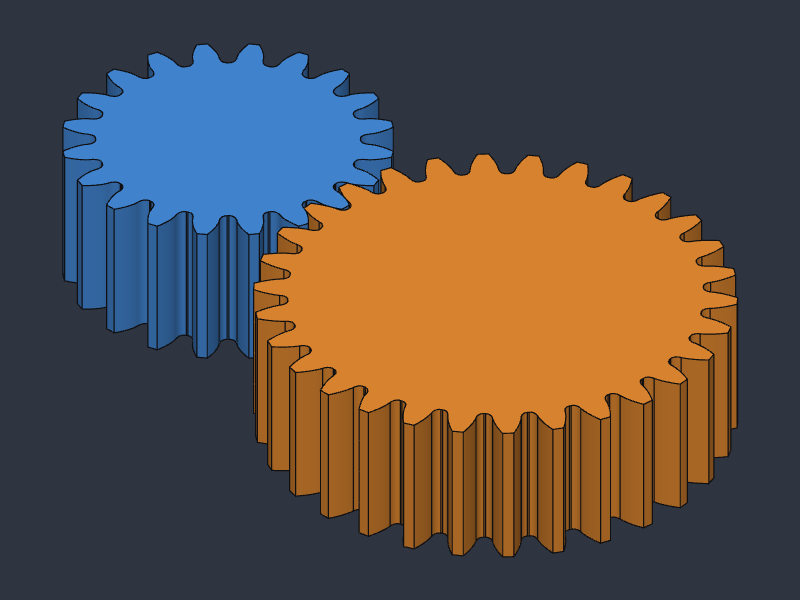 | **Spur** | Two touching pitch circles in one sketch |
| 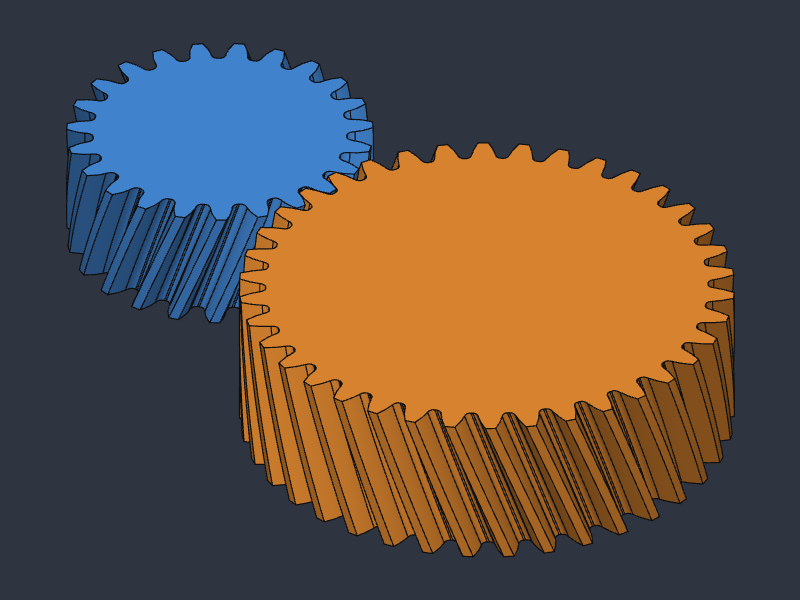 | **Helical** | Same as spur; set the helix angle and opposite hands |
| 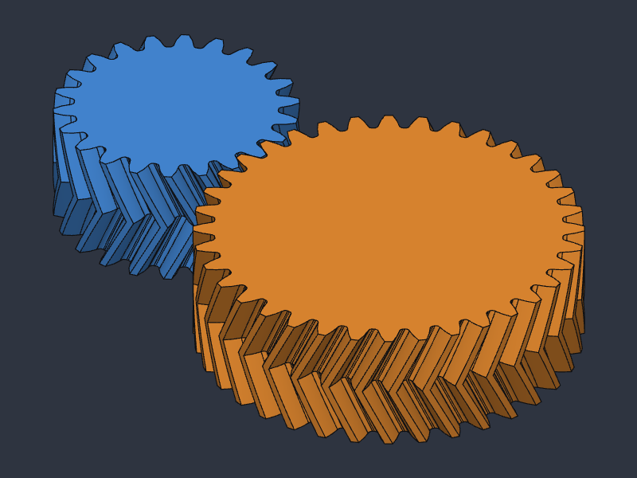 | **Herringbone** | Same as spur; V teeth with no axial thrust |
| 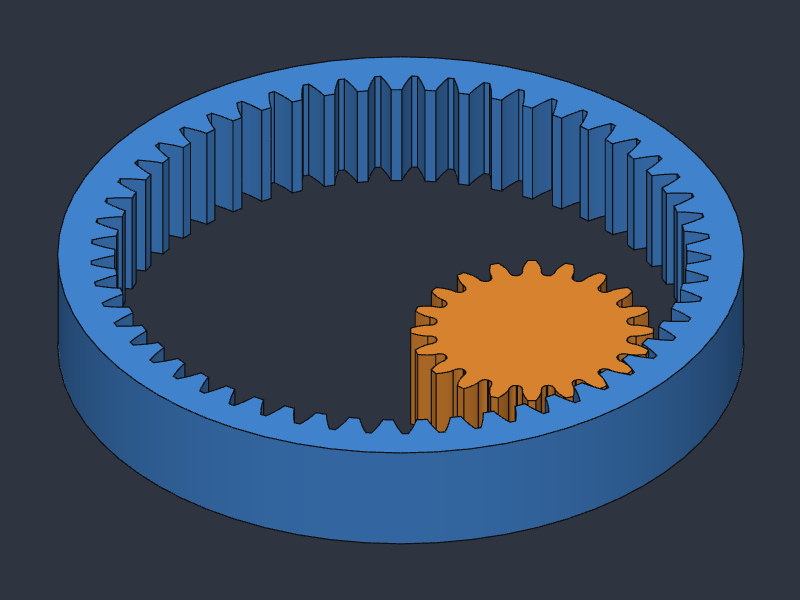 | **Ring Gear (internal)** | The ring's pitch circle with the pinion's circle touching it from inside |
| 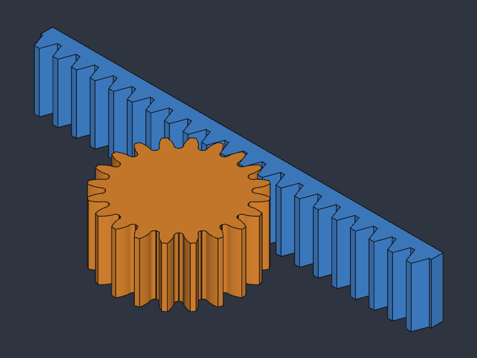 | **Rack** | A line for the rack's pitch line, with the pinion's circle tangent to it |
| 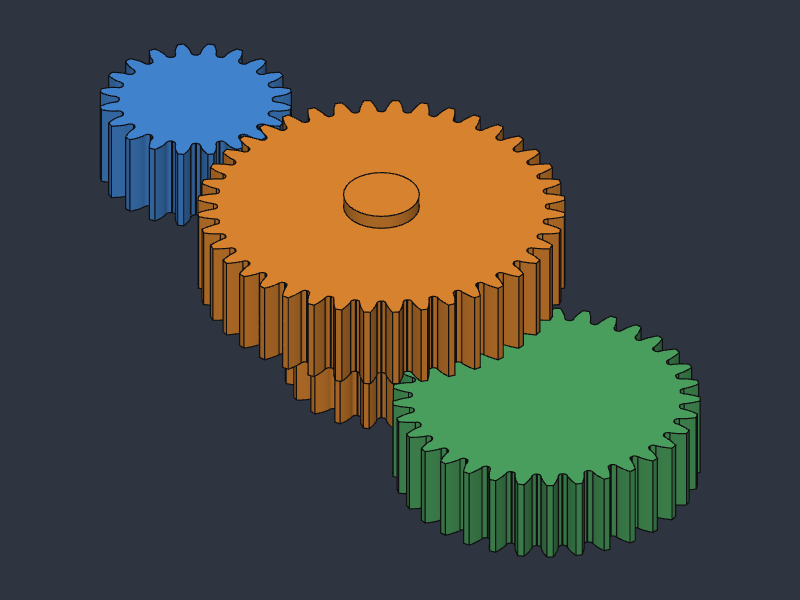 | **Compound** | A shaft line with one circle per layer, in parallel sketch planes |
| 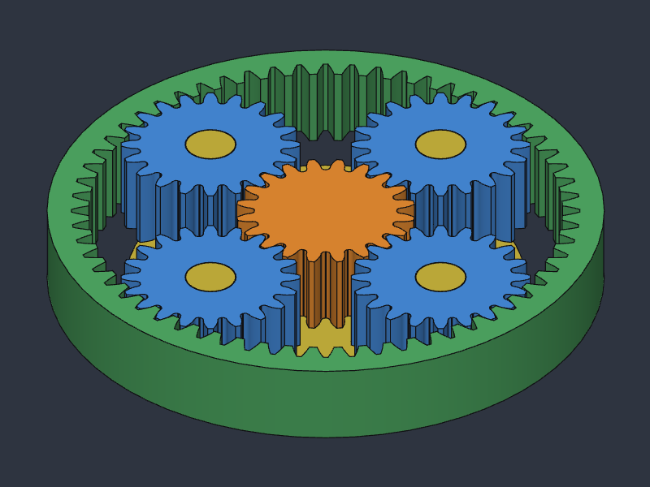 | **Planetary** | Concentric sun and ring circles plus one planet circle; the carrier is generated |
| 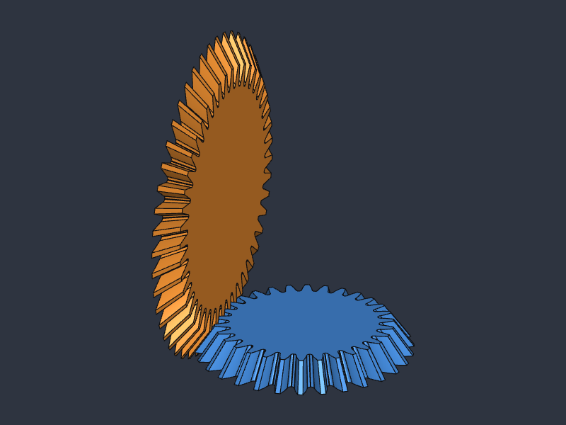 | **Bevel Pair, straight** | One side view: apex point, two shaft lines and a contact line that sets the ratio |
| 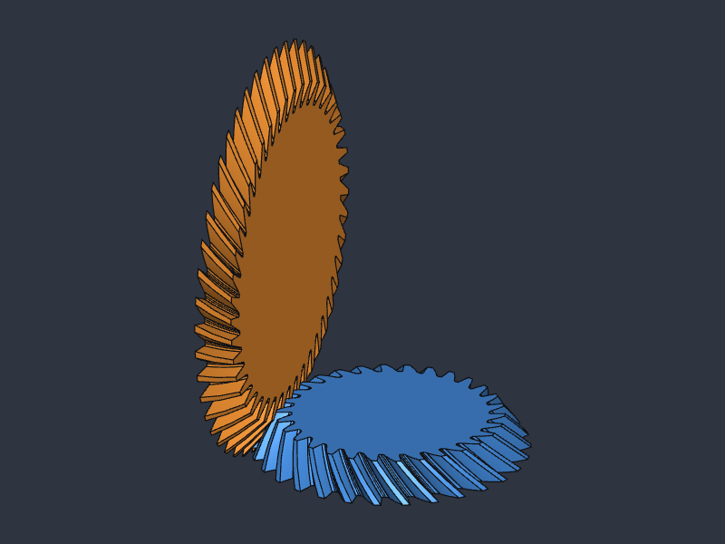 | **Bevel Pair, spiral** | The same side view, with the spiral style |
| 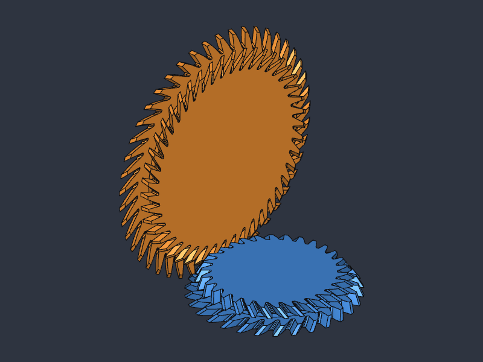 | **Bevel Pair, chevron** | The same side view, with the chevron style (V teeth) |
| 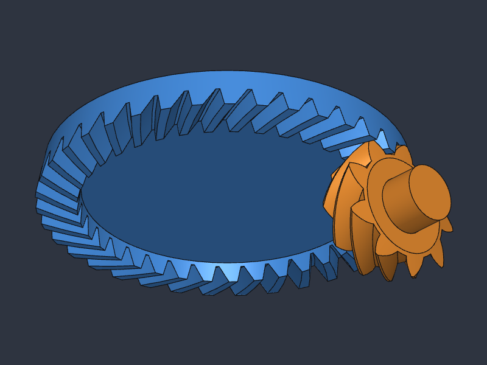 | **Hypoid Pair** | The ring's pitch circle and the pinion's axis line, offset from the centre |
| 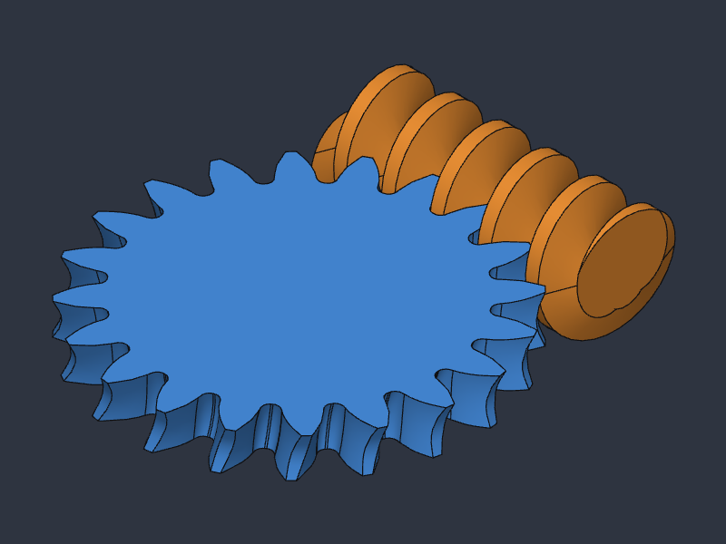 | **Worm and Wheel** | The wheel's pitch circle and the worm's axis line in one sketch |
| 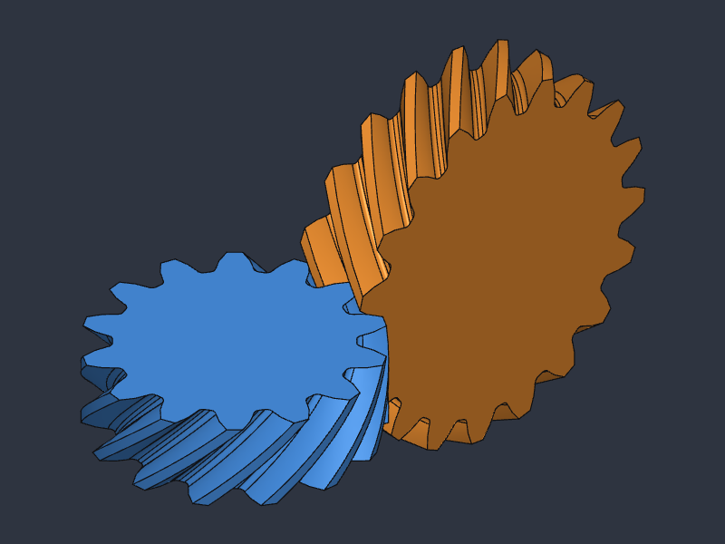 | **Crossed Helical** | Two circles on axes that pass each other, their radii adding up to the distance between the shafts |

The examples behind these renders are in [`examples/gears/`](../../examples/gears/README.md). See
[gear types](gear-types.md) for every sketch slot.
