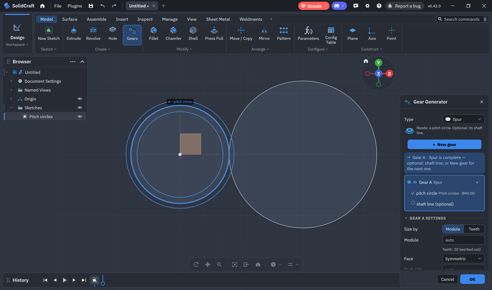

# The Gears dialog, tab by tab

The dialog is a panel on the right titled **Gear Generator**. It has a fixed width and keeps the
same layout on every tab:

- a **row of icon tabs** across the top (hover one for what it holds);
- the tab's **name** and the **[status line](#the-status-line)** under it, which stay put;
- the tab's **groups**, which scroll inside the dialog;
- **OK** and **Cancel**, fixed at the foot.

| Tab | Icon | What it holds |
|---|---|---|
| [Gears](#gears) | gear generator | Type and **New gear**, a card per gear, and the selected gear's size and face |
| [Teeth](#teeth) | helical gear | The selected gear's helix (or bevel style) and profile shift; the tooth form and chamfer of every gear |
| [Shafts & Bearings](#shafts--bearings) | bearing seat | The shaft made on each axis and from which block, the selected gear's bore and hub, a shaft's Ø, the bearing points |
| [Links & Motion](#links--motion) | motion link | Meshes and shared shafts, suggested links, the drive, the ratio between two gears, the graph |
| [Housing & Output](#housing--output) | housing cutout | The housing cutout and its bearing seats; operation, Targets, keep-out, assembly |
| [Differential](#differential) | differential | Only while a ring gear carries a differential: its style, pinions, module, half-shafts and facts |
| [Results](#results) | list | Each gear's numbers, every warning, the planner's notes and facts |

A red dot on the Gears tab means a gear has an error or a missing pick; an amber dot on Results
means there are warnings. The tab you chose stays while the dialog is open; each tab keeps its own
scroll position.

**Groups.** A titled group folds with the arrow in its heading, and stays as you left it. A group
with a **checkbox** in place of the arrow (Tooth chamfer, Hub, Housing cutout, Cut keep-out,
Differential in the ring gear) is switched on by its checkbox, and its rows show,
indented under a rule, only while it is on.

**The selected gear.** The per-gear groups (Gears below the cards, Teeth, Shafts & Bearings) show
the selected gear: the one whose card you clicked last. Teeth and Shafts & Bearings have a
**Gear** row at the top to choose another; choosing one there selects it, as clicking its card
does, so your next picks in the view go to it. With **—** chosen, only the set's own groups show.
An item that makes several gears (compound, pair, planetary, ring with pinion, rack with pinion)
has a second **Gear** row of segments (B1, B2; wheel, worm; sun, ring, planet; …) where it
matters: each gear has its own size, face, helix, bore and hub.

**Typing values.** Every number field takes a plain number or an expression with units, as other
SolidCraft fields do (`2`, `2 mm`, `20 deg`). An empty field, or `auto`, means Auto. Lengths are in
millimetres unless you type a unit. A value that doesn't read gives a message such as "Gear A gear 1:
module: … type a number, or leave it empty for Auto".

## The status line

Always one line under the tab's name, on every tab, saying what to do next, for example:

- "Press New gear (or click a circle in the view) to start a Spur gear"
- "Gear B · Compound — click: shaft line"
- "Gear A · Spur is complete — optional: shaft line; or New gear for the next one"
- "Gear B · Bevel Pair is complete — sized by its gears' teeth and module (20 teeth each at module 2 until you set them under Gear B on the Gears tab); or click its contact line to size it from the drawing"
- "Click a gear's card to change it, or New gear for another"

A refused pick turns it into a warning (⚠, warning colour): "That pick doesn't fit: …" with the
reason and what to do. A missing reference also shows here: "Gear B · Spur — its curve b of sketch
'Pitch circles' is missing: click its replacement in the view". While the **Targets** chip is
active (Housing & Output), it says "Click the bodies the gears act on (Targets). Click a gear's card
to go back to picking gears."

## Gears

### Type and New gear

| Control | What it does |
|---|---|
| **Type** | The type the next gear is made as. 12 types: Spur, Helical, Herringbone, Ring Gear, Rack, Compound, Planetary, Bevel Pair, Hypoid Pair, Worm and Wheel, Crossed Helical, Shaft. When the dialog opens on an existing set, it starts on the first gear's type. |
| *(picture and "Needs:" line)* | What the type needs you to pick, e.g. "Needs: a pitch circle. Optional: its shaft line." |
| **+ New gear** | Starts a new, empty gear of the chosen type and selects it. Your next picks go to it. |

You don't have to press New gear. When no gear is waiting for a pick (none is selected, or the
selected one is complete and the pick doesn't fit it), clicking geometry starts a new gear of the
chosen type. Box-selecting several circles makes one gear per circle. Where a point sits on a
line (a bearing point on a shaft line, the apex where a bevel's two shaft lines meet), a click
there picks the point; click the line away from its points to pick the line.

With no gears yet, a guide box shows three steps and the hint "Then link them on the Links &
Motion tab: touching circles are suggested for you."

A message several gears share (one under-defined sketch) is said once above the cards, naming the
gears, with an **Edit sketch** button.

### Gear cards

One card per gear item, named **Gear A**, **Gear B**, … (after Z: A2, B2, …). Each card has:

- a **colour dot** (the same colour is used for its geometry and outline in the view);
- the type icon, the name and the type;
- **▶ driver** when it is the driver;
- **×** to remove it (its links go too).

**Click a card** to select the gear: your picks go to it and its settings show below the cards
(and on Teeth and Shafts & Bearings). **Hover** a card to light its geometry in the view.

While a card is selected (or incomplete) it shows a **checklist**:

| Mark | Meaning |
|---|---|
| ✓ | filled; the pick is named by its sketch and size ("Pitch circles · Ø40.00", "Shaft · 120.00 long") |
| → | the next slot to fill ("click one in the view") |
| ● | still required |
| ○ | optional ("shaft line (optional)", "bearing point (optional, repeats)") |

A compound's circles are listed as "B1 pitch circle (first layer)", "B2 pitch circle (second
layer)", …

**Bore and hub circles.** For spur, helical, herringbone and compound gears, circles drawn on the
gear's centre inside its pitch circle are listed as **bore circle** / **hub circle**:

- on a gear made in this session they are taken automatically (✓ with **×** to take one out; one
  taken out stays out);
- on a reopened set they are offered with their diameter and a **Use** button.

A complete card that isn't selected folds to one line: its teeth and module, and bore and hub if
any ("z20 m2 · bore 8 · hub 16"; a compound lists each gear).

**Messages** sit on the card they are about: ⚠ warnings and × errors, with what to do, and a button
for each fix a refusal names ("Use module 1.5", "Use 11 teeth on B"). See
[Troubleshooting](troubleshooting.md). Every message is also listed on [Results](#results).

### Blocks

Under the cards, the group **Blocks** puts gears under shared settings. With no block yet it holds
one button, **Put all gears in one block**. Each block then shows its name in its colour with
**×** (remove the block; its gears keep their own settings), and:

| Row | Default | Meaning |
|---|---|---|
| **Gears** | | A tick per gear: the gears in the block. A gear is in one block at most. |
| **Name** | Block 1 | Its name, in the view and the lists. |
| **Module** | auto | One module for every gear in the block, so they can mesh. |
| **Shaft Ø** | none | Every gear in the block gets a bore of this Ø, and each axis the block's gears are on gets a shaft of this Ø, joined to the gears on it as **one body per axis**. The shaft runs over the gears' faces and a little past them (the Ø, at least 3 mm), or out to the bearing points on that axis. A line under the row says what is made ("2 shafts, bored into their gears: A + C (34 mm), B (22 mm)"). |
| **Face width** | each gear's | The whole face width of every gear in the block, half each side of the sketch plane. |
| **More** (folded) | | **Helix angle**, **Pressure angle**, **Backlash**, **Tooth chamfer**: each for every gear in the block (the tooth chamfer in place of the set's). |

A gear's own value (its own module when sized by teeth, its own face, helix or bore) wins over the
block's; where it is left on Auto, the block's applies. **New block** makes another block with the
gears in none yet. The fields sit two to a row.

### The selected gear's group

Under the cards, the group **Gear X · Type** (open) holds the selected gear's own settings, then
its size.

| Type | Row | Default | Meaning |
|---|---|---|---|
| Ring Gear | **Rim** | auto: 2.5 × module | Rim thickness outside the tooth roots (mm). |
| Worm and Wheel | **Starts** | auto | Thread starts on the worm. More starts turn the wheel faster and lock less. The wheel is always throated: its rim wraps round the worm. |
| Rack | **Back height** | auto | Material behind the rack's tooth roots (mm). |
| Planetary | **Planets** | auto | How many planets: Auto fits as many as there is room for, 3 at most. |
| | **Carrier** | on | Generates a carrier body that the planets turn on. |
| Shaft | **Shaft Ø** | auto | Shaft diameter. A Shaft item has only this; it has no teeth. |

All of these are applied to the built set. A bevel or hypoid pair's **Style** and **Spiral angle**
are on [Teeth](#teeth).

**Size by, Module, Teeth**

| Row | Default | Meaning |
|---|---|---|
| **Size by** | Module | **Module**: you set the tooth size; the tooth count follows from the drawn circle. **Teeth**: you set the count; the module follows (pitch Ø ÷ teeth). |
| **Module** | auto | Tooth size in mm. Auto: the largest standard module that gives the smallest gear of the meshing group 17 teeth or more. The caption shows the count worked out: "Teeth: 20 (worked out)". |
| **Teeth** | from the circle | The tooth count. The caption shows "Module: … (worked out)". |

Meshing gears share one module: setting it on one gear sets it for its mates. If the gear is in a
**block**, the Module row edits the block's module, and the caption says
"Block 1: gears A, B · teeth: …"; a face left on Auto shows the block's face width as its hint. Until the gear is complete, the caption reads "— until the gear
is complete".

**Face**

| Preset | Fields | Auto |
|---|---|---|
| **Symmetric** (default) | **Each side** | 5 × module each side (10 × module in all) |
| **A only** | **Side A** | 10 × module, all on side A |
| **B only** | **Side B** | 10 × module, all on side B |
| **Custom** | **Side A**, **Side B** | both empty: 5 × module each side; one given: the other is 0 |

The face is how far the teeth reach from the sketch plane along the axis, on each side.
Note that **Each side** is per side: `10` gives a 20 mm face. Side A is the green arrow in the view
(see [Sketch conventions › Side A](sketch-conventions.md#side-a-and-side-b)). Use A only / B only
to grow a gear out of one face of its sketch, for example two gears on one shaft drawn in one
plane. A bevel pair whose face is left on Auto gets at most a third of its cone distance, so
its small ends aren't weak.

Meshing gears' faces must overlap along the axis; gears on one shaft must not overlap.

**Differential in the ring gear** (Bevel Pair and Hypoid Pair, checkbox group). Shown only when the
build's engine takes a differential. Ticked, the pair's ring gear (the hypoid's ring, the bevel
pair's larger gear) carries a differential and the [Differential](#differential) tab appears; the
group's **Differential tab →** button opens it. Unticked, the differential goes and so does the tab.

## Teeth

**Gear** row: the gear these rows are for (see [the selected gear](#the-gears-dialog-tab-by-tab)).

### Gear X · Type

| Row | Default | Meaning |
|---|---|---|
| **Style** (Bevel Pair, Hypoid Pair) | Straight | Straight, Spiral or Chevron (V teeth: the spiral changes hand at mid-face). Hypoid has a spiral regardless. |
| **Spiral angle** | 35 deg | Tooth angle at mid-face (shown for Spiral, Chevron and Hypoid). |
| **Helix angle** (not bevel, hypoid, worm) | 0 = straight (Helical and Herringbone start at 20 deg) | Tooth angle to the axis. Meshing gears share one helix angle. |
| **Hand** | Auto | Shown when the helix isn't 0 (a choice on a planetary set; elsewhere a caption: "Hand: worked out, opposite across each mesh"). Auto: opposite its mate across an outside mesh, the same inside a ring and on one shaft. |
| **V teeth (herringbone)** | off (on for Herringbone) | Two opposite helices meeting in the middle. Meshing gears both have V teeth, or neither. Needs a helix angle. |
| **Profile shift** | worked out | Read only: the shift the planner chose to hold the drawn centre distance and clear undercut. |

A Shaft gear says "A shaft has no teeth."

### Tooth form · every gear

Open. The defaults every gear of the set takes.

| Row | Default | Meaning |
|---|---|---|
| **Pressure Angle** | 20 deg | Tooth flank angle. |
| **Backlash** | 0 | Play between meshing teeth, taken from each tooth's thickness (mm). |
| **Tip Rounding** | × module | Round the tooth tips, as a fraction of the module. |
| **XY Compensation** | 0 | Shrink (or grow) every tooth flank for a printer's over-extrusion (mm). |
| **Equation teeth** | off | Shown only when editing an older set made as a folder of formula features. *(See [Troubleshooting](troubleshooting.md#equation-teeth).)* |

### Tooth chamfer · every gear (checkbox group)

Off by default. Ticked:

| Row | Default | Meaning |
|---|---|---|
| **Size** | empty: none | A 45° chamfer off the tooth tips' edges on the end faces (mm across, as deep). Applied to spur, helical and herringbone gears (outer ends), each compound layer and ring gears. Bevel, worm, hypoid, crossed helical, rack and planetary gears stay plain, and a note says so. A chamfer as big as the tooth's addendum, or half the face, is refused, naming the gear. |
| **Faces** | Both | Both, Side A or Side B (side A is the green arrow in the view). |

Unticking the group clears the size: no chamfer is made. The preview draws the chamfer on each
chamfered end: the tip circle stepped in by the size, a second circle the size back from the face,
and short slanted lines between them.

## Shafts & Bearings

### Shafts · n

One row per shaft the set makes: each block's shaft ("Shaft M1·1 — Ø8 × 34 mm · gears A + C ·
from Block 1", in the block's colour), and each Shaft gear drawn by hand. With none, it says how to
get them: put the gears in a block and give it a Shaft Ø.

**Gear** row: the gear these rows are for. A gear in a block with a Shaft Ø shows "Auto: 8 mm, the
shaft Ø of Block 1" under its Bore row.

### Gear X · Type

| Row | Default | Meaning |
|---|---|---|
| **Shaft Ø** (Shaft gears) | auto | Shaft diameter (the same row as on the Gears tab). |
| **Bore** | Auto | Auto or Ø. **Auto** fits the shaft when a shaft line is picked; otherwise no hole, unless a bore circle is drawn. **Ø** shows **Bore Ø** (mm) and cuts that hole. A drawn bore circle wins over this setting. A bore (Ø or drawn) means the gear goes on a shaft of its own, so no shaft stub is built from its shaft line; a compound keeps a sleeve between its layers, bored through. |
| **Hub** (checkbox group) | off | A boss on the gear's face. **Hub Ø** (mm; auto: 1.6 × the bore, or about half the root Ø with no bore), **Length A** and **Length B** (mm past the face on each side; both 0: half the face width on side A). A drawn hub circle gives the Ø. |

A bore at or past the tooth roots is left out with a warning; a hub wider than the roots gets a
warning.

### Bearing points · n

The bearing points picked on each gear's shaft line ("Gear D · 2 points"), and what becomes of
them: a bearing seat at each in the housing cutout when it is on (Housing & Output), or a hint to
turn it on.

## Links & Motion

With fewer than two gears (and no links) the tab says to make them on the Gears tab.

Every link is drawn in the view while the dialog is open: a line from one gear's centre to the
other's (a mesh through the point where the pitch circles touch) with its ratio, in its block's
colour (grey between gears of different blocks, red when it can't be built), suggested links
dashed. **Hover a link row** to light that link and its two gears in the view.

| Group | What it holds |
|---|---|
| **Links · n** (open) | **Link rows**: "A ⟷ B mesh 0.67 : 1 opposite" or "B ═ C same shaft", each with **×**. The ratio is the second gear's speed over the first's, with its direction. A link that can't be built shows its error under it in red. **Suggested links** (italic, "· suggested") and one **Accept suggested (n)** button. Suggested = circles the drawing shows as touching, or gears on one axis. With no links and no suggestions: "No links yet: add one below." |
| **Add a link by hand** (open only when there is nothing yet) | **Gear**, **Link** (Mesh or Same shaft), **With gear**, **Add link**. |
| **Drive** (open) | **Driver**: the gear you turn. Every other gear's speed and direction follow from it; "—" means none (the assembly is then driven from the first gear). **Input rpm** and **Input torque** (N·m), both optional, shown once a driver is chosen; they fill speed and torque per gear in Results. |
| **Ratio between two gears** (open) | **Ratio from** / **to**: pick two gears to read the ratio between them: **Ratio** (to's speed over from's, and the direction), **Path** (the chain of meshes and shared shafts), **Efficiency** and, for a rack, **Rack travel** per turn. See [Motion and ratios](motion-and-ratios.md). |

## Housing & Output

### Housing cutout (checkbox group)

Off by default. See [Housing cutout](housing-cutout.md) for the full page.

| Row | Default | Meaning |
|---|---|---|
| **Housing cutout** | off | Adds one body, "Housing cutout": the space the drivetrain needs to turn plus a bearing seat at every bearing point. |
| **Bearing** | 608 — 8 × 22 × 7 | One bearing size for every seat (bore × OD × width, mm), or **Custom…** with **Bearing OD**, **Bearing width** and optional **Bearing bore**. |
| *(count line)* | | "No bearing points yet: …", "1 bearing point: a seat there.", "3 bearing points: a seat at each." |
| Gaps and fit › **Radial gap** | 0.5 mm | Gap round every tip envelope and shaft. |
| Gaps and fit › **Axial gap** | 0.5 mm | Gap past each gear's faces along its axis. |
| Gaps and fit › **Seat fit** | 0 | How much larger than the bearing OD each seat is, on the diameter. |
| Gaps and fit › **Shaft run-on** | 2 × face | How far each shaft's clearance runs past its gear on each side. |

### Output

| Row | Default | Meaning |
|---|---|---|
| **Assembly (joints and gear links)** | on | Each rigid part (a gear, a compound, a gear with its shaft) becomes a component on a revolute joint, linked to its mates by the gear ratio. |
| **Operation** | New Body | New Body: separate bodies. Join, Cut, Intersect: combine the gears with the **Targets**. |
| **Cut keep-out from Targets** (checkbox group) | off | Cut the space the gears sweep (plus the gap) out of the Targets, e.g. a housing you already modelled. Its **Keep-out gap** (auto) is the extra room round the swept teeth (used as both the radial and the axial gap). |
| **Targets** | | Shown when the operation isn't New Body or keep-out is on. Click the chip, then click bodies. Click a gear card to go back to picking gears. |

Join, Cut and Intersect need Targets: "Join, Cut and Intersect act on the Targets: pick the bodies
(Housing & Output tab › Targets)".

## Differential

Shown only while a bevel or hypoid pair's **Differential in the ring gear** is ticked (Gears tab),
and only in a build whose engine takes a differential (the item's `differential` in
[scripting](scripting.md)). With several such pairs, a **Ring gear** row chooses which one.

| Row | Default | Meaning |
|---|---|---|
| **Differential in the ring gear** | on | Untick to remove the differential; the tab goes and Gears shows. |
| **Style** | Open | **Open** (bevel side gears and spider pinions), **Biased** (uneven side gears: it biases torque), **Torsen B** (helical elements, a planetary), **Torsen A** (worm elements). The caption gives the full name. |
| **Pinions** (Open, Biased) / **Element pairs** (Torsen) | auto: 2 (Torsen B: 3) | Spider pinions on the case, 1 to 6; element gear pairs, 1 to 8. |
| **Module** | auto | The side gears' and pinions' module (mm). Auto: the largest whose case is at most 0.6 × the ring's pitch Ø. |
| Half-shafts › **Length** | auto: 1.5 × ring Ø | Each half-shaft's reach from the differential's middle along the ring's axis (or to the ends of a Shaft gear drawn on that axis). |
| Half-shafts › **Ø** | auto | The half-shafts' diameter: that Shaft gear's, else 0.4 × the side gears' pitch Ø. |

**Facts · n** lists what the planner worked out for it (module, side gear and pinion teeth, case
size, bearings, pins, half-shaft lengths, ring bolts), and any message about it, such as a ring
too small for a differential.

## Results

| Group | What it holds |
|---|---|
| **Gears · n** (open) | One row per gear once the set is worked out: **z** (teeth), **m** (module), **Ø** (pitch diameter), the ratio to the driver, rpm and N·m (with an input), and the contact ratio. Hover a row for torque, contact ratio, profile shift and its warnings. |
| **Warnings · n** (open) | Every message, the set's first, then each gear's ("Gear B: …"). They also show on the cards. |
| **Notes** (open) | Notes from the planner in small text ("2 bodies from 1 stage", "module block M1: module 2", …). |
| **Facts · n** (closed) | Every fact the planner gives: diameters, centre distances, contact ratios, the housing cutout's envelope and bearing, a differential's case. |

With nothing worked out yet: "Nothing worked out yet: complete a gear on the Gears tab."

## OK and Cancel

- **OK** on a new set runs `gear.create`: one Gears feature (in a folder with its joints when
  Assembly is on).
- **OK** on an existing set runs `gear.update` in place. If nothing changed, OK just closes.
- **Cancel** leaves the design as it was.

The tabs only arrange the form: the request OK sends is the same whichever tab is open.

The view shows only outlines while the dialog is open (pitch, tip and root circles at both faces,
the tooth chamfer when one is set, each gear's picks in its colour and labelled "B · shaft line",
each mesh's contact in yellow, the selected gear's side-A arrow). The teeth are built on OK.
