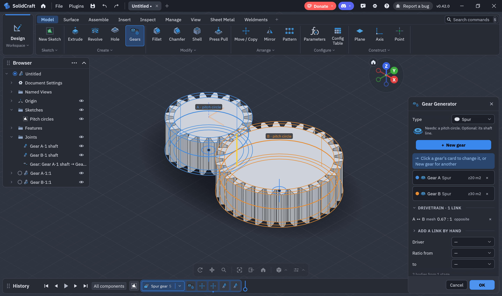
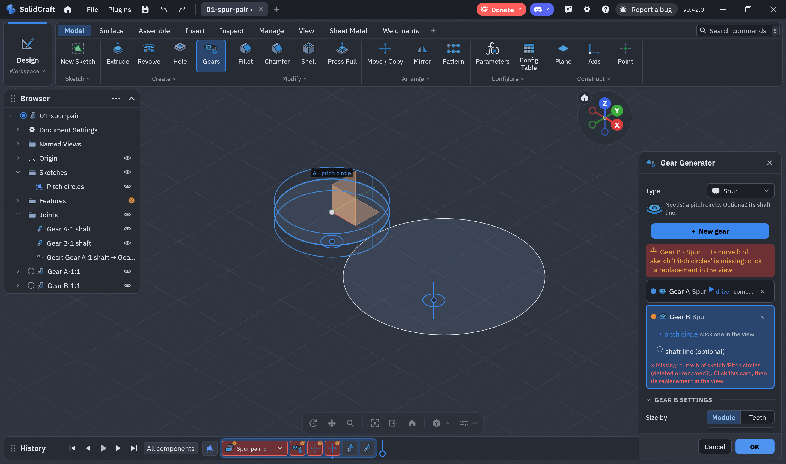

# Editing and sketch changes

## Reopening a set

Any of these opens the Gears dialog on an existing set, with its gears, links, driver and output
settings restored:

- double-click the set's row (or folder) in the History timeline, or right-click it › **Edit
  Gears**;
- double-click one of its gears in the view (in an assembly the gear is a component; the
  double-click opens the set instead of activating the component);
- select one of its bodies or components, or its timeline folder, and click **Gears**;
- with a gear's component active and nothing selected, click **Gears**.

Change what you need and press **OK**: the set is updated **in place** (`gear.update`). If nothing
changed, OK just closes.

What an update keeps:

- **body names**: bodies are named by item and gear (**Gear A·1**, **Gear B·1+2** for a compound,
  **Carrier P**, **Planet P 2**). A body whose item and gear are still there keeps its name, even
  when you add or remove other gears; a body you renamed keeps your name;
- **components and joints**: they stay on the bodies and are moved onto the new shafts; the gear
  links get the new ratios; joints you made to the gears are kept.

Adding a gear to an existing set: press **New gear** (or click a new circle) in the reopened
dialog. Removing one: **×** on its card.

## When the sketch changes

The Gears feature reads its sketches again every time the design is recomputed. Each picked
entity is found by its sketch and its own id, so:

- **Change a dimension** (a circle's diameter, a centre distance, a shaft length): the gears are
  re-planned in place. Tooth counts follow the new diameters at the same module; the drawn centre
  distance is held by profile shift.
- **Move geometry**: the gears move with it; bearing seats in the housing cutout move with their
  points.
- A sketch with **degrees of freedom** can let the gears drift when something else in the sketch
  moves. That's why each gear on an under-defined sketch carries the warning "sketch '…' isn't
  fully defined (n degrees of freedom): dimension it so the gears can't drift".

If a change makes the set impossible (circles no longer touching, a bore past the tooth roots,
stages that collide), the feature fails with the message, like any failed feature. (An OK in the
dialog that would fail is rolled back instead: the design stays as it was.) Fix the sketch, or reopen the dialog to see the message on the card
it belongs to.

## Deleted or renamed references

References are **never silently re-picked**. If a picked circle, line or point is deleted (or its
sketch is deleted), nothing else is read in its place:

- The feature fails and names exactly what is gone, for example:
  - "item B, pitch: curve `b` is gone from sketch 'Pitch circles': pick the pitch again, or draw it
    again with id `b`"
  - "item A, axis: sketch 'Shafts' is gone (deleted): pick the axis again"
  - "item A, pitch: sketch 'Layer 2' isn't there before the Gears feature (it comes after it in the
    timeline, or it is suppressed or failed): move it before the Gears feature"
- Reopen the set. The gear with the missing pick opens **active**, the status line says "Gear B ·
  Spur — its curve b of sketch 'Pitch circles' is missing: click its replacement in the view", and
  the card shows "Missing: curve b of sketch 'Pitch circles' (deleted or renamed?). Click this card,
  then its replacement in the view."
- Click the replacement in the view. It takes the missing pick's place. Press OK.

If you don't want the gear any more, press **×** on its card instead.

## Sketch order

A Gears feature reads only sketches that come before it in the timeline. If you add a gear drawn in
a new sketch (made after the feature), OK on the edit moves that sketch to just before the Gears
feature. If it can't be moved, the message says "sketch … comes after the Gears feature and can't be
moved before it".

## Sets made with the earlier dialog

A set made with the earlier Gears window (one type read from a whole sketch, or rows with roles)
opens as it is, with the note "Made with the earlier Gears dialog: … It still follows its sketch; OK
keeps it as it is." For spur, helical, herringbone, pair, internal, planetary and train sets (and
any set made from picked rows) a **Convert to gears** button makes each of its circles a gear of
the new kind, so you can edit them one by one. The set is replaced by the gears on OK.
