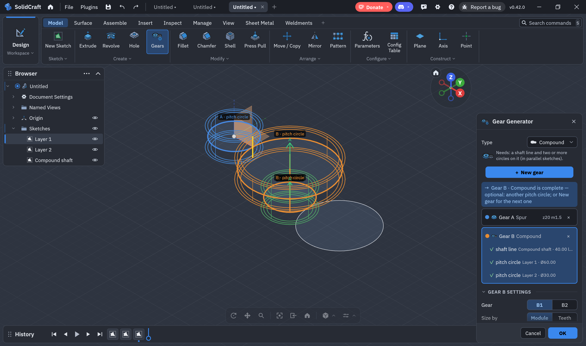
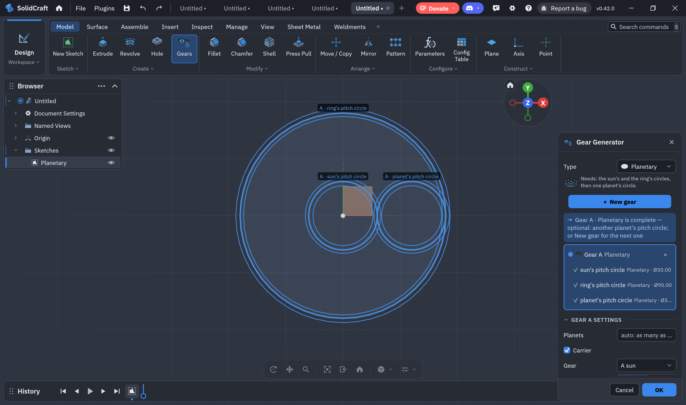
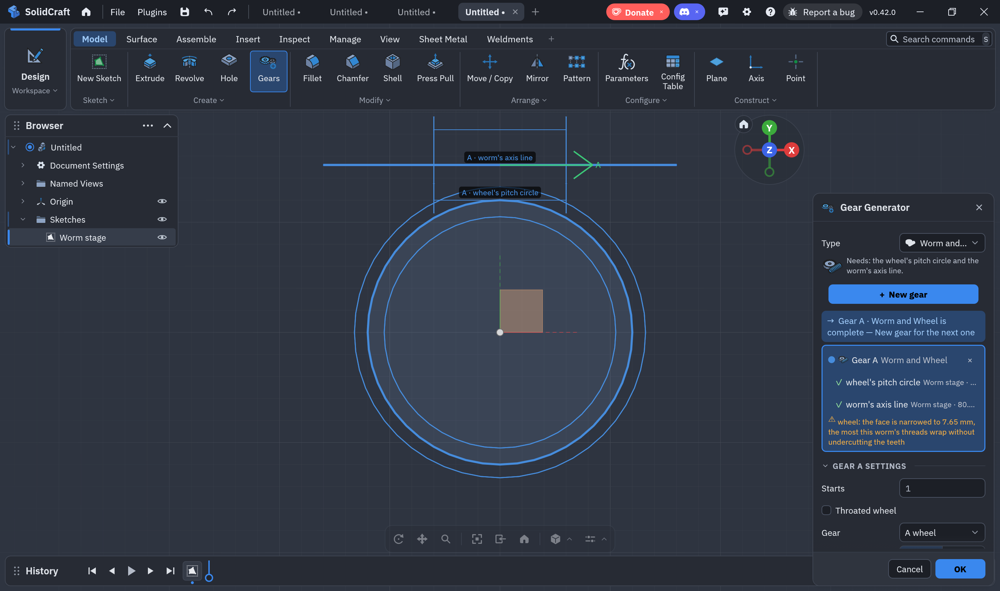

# Gear types

Each type lists the sketch pieces it takes, in the order the status line asks for them. Required
slots are marked ●, optional ○. The **gears** column gives the names the dialog uses for the gears
of one item (they appear in tabs, links and Results).

| Type | Slots | Gears | Example |
|---|---|---|---|
| [Spur](#spur-helical-herringbone) | ● pitch circle, ○ shaft line, ○ bearing points | A | `01` |
| [Helical](#spur-helical-herringbone) | same as Spur | A | `02` |
| [Herringbone](#spur-helical-herringbone) | same as Spur | A | `08` |
| [Ring Gear](#ring-gear-internal) | ● ring's pitch circle, ○ pinion's pitch circle | ring, pinion | `07` |
| [Rack](#rack) | ● rack's pitch line, ○ pinion's pitch circle | rack, pinion | `09` |
| [Compound](#compound) | ● shaft line, ● pitch circle × 2 or more, ○ bearing points | B1, B2, … | `03` |
| [Planetary](#planetary) | ● sun's pitch circle, ● ring's pitch circle, ○ planet's pitch circle | sun, ring, planet | `06` |
| [Bevel Pair](#bevel-pair) | three layouts, see below | B1, B2 | `04` |
| [Hypoid Pair](#hypoid-pair) | ● ring's pitch circle, ● pinion's axis line | ring, pinion | `10` |
| [Worm and Wheel](#worm-and-wheel) | ● wheel's pitch circle, ● worm's axis line | wheel, worm | `05` |
| [Crossed Helical](#crossed-helical) | ● pitch circle 1, ● pitch circle 2 | A1, A2 | |
| [Shaft](#shaft) | ● shaft line, ○ bearing points | (no gear) | |

Examples are in [`examples/gears/`](../../examples/gears/README.md).

## Spur, Helical, Herringbone

**Sketch:** one circle per gear. Optionally a shaft line through its centre, square to the circle's
plane, and points on that line for bearings.

**Pick:** the circle, then (optional) the shaft line, then the bearing points.

**What you get:** one gear body. With a shaft line, a round shaft along the line (between its ends)
built as one part with the gear, the gear's bore fitting it. The three types differ only in their
starting settings: Helical starts with a 20° helix, Herringbone with 20° and V teeth. You can turn
any of them into the others with the Helix rows.

Mesh two of them by drawing their circles tangent (one sketch plane) and accepting the suggested
link. On one shaft: draw them in parallel sketch planes with their centres on one axis and link them
**Same shaft** (or use a Compound).

The circle must be square to its shaft line and centred on it, or the pick is refused ("the pitch
circle is tilted 12° to the shaft line…", "the pitch circle's centre is 0.8 mm off the shaft
line…").

## Ring Gear (internal)

**Sketch:** the ring's pitch circle and, optionally, the pinion's circle inside it, in the same
plane, touching it from inside (pinion centre at ring radius − pinion radius).

**Pick:** both circles, in any order: the larger is always the ring.

**What you get:** a ring gear (teeth inside, rim outside) and its pinion, meshing. Without the
pinion circle you get the ring alone; mesh a separate spur gear to it with a link (the circle
touching the ring from inside is suggested).

## Rack

**Sketch:** a line for the rack's pitch line and, optionally, the pinion's circle tangent to it in
the same sketch.

**Pick:** the line first, then the circle.

**What you get:** a straight rack whose tooth count fills the line's length, and its pinion. In
the assembly the rack slides on a slider joint. A helical pinion's rack is built with straight
teeth (a warning says so); use a spur pinion. A rack with several pinions is not made yet.

## Compound

Two or more gears on one shaft, made as **one body**.

**Sketch:** a shaft line, and one circle per gear in **parallel sketch planes** (one per layer),
each centred on the line and square to it. Two circles may not sit at the same place along the
shaft.

**Pick:** the shaft line first, then the circles. The status line keeps offering "another pitch
circle" until you start a new gear.

**What you get:** one rigid body with all its gears (named like "Gear B·1+2"); each gear (B1, B2,
…) has its own size, face and helix in the settings tabs. Mesh each layer's gear with gears drawn in
the same layer.

## Planetary

**Sketch:** in one sketch, the sun's circle and the ring's circle, concentric; optionally one
planet's circle touching both (radius = (ring − sun) / 2).

**Pick:** sun and ring (either order: the larger is the ring), then the planet. Without a planet
circle, one is placed for you.

**What you get:** sun, ring and planets (the **Planets** setting: Auto fits up to 3), and a
generated **carrier** the planets turn on (bodies "Carrier P", "Planet P 2", …). The module comes
from the sun's settings. A planetary set's gears mesh only within the set: to drive it from outside,
link another gear to its sun or ring by **Same shaft**.

## Bevel Pair

Two gears whose shafts meet at an angle. Three ways to draw it:

1. **Two circles** on axes that meet, each the same distance from where the shafts meet (a circle
   in each of two planes at an angle).
2. **Two axis lines and one circle**: the lines meet at the apex; the circle sits square to one of
   them, centred on it. The mate's size follows.
3. **Side view** (one sketch): the **apex point**, **two shaft lines** from it and, optionally, a
   **contact line** from the apex between them. The contact line's angle to each shaft sets the
   ratio; its length sets the cone distance. Without a contact line, the size comes from the gears'
   teeth and module (set Size by Teeth on both gears and a module). Two shaft lines that start at a
   common end can be picked without the point: that end is the apex. Pick in any order.

**What you get:** a straight, spiral or chevron bevel pair (Style row), any shaft angle. Example
`04` is a side view: z30 / z45, module 2, 1.5 : 1.

Shafts that are parallel are a spur pair; shafts that pass each other without meeting need a
Hypoid or Crossed Helical pair. The messages say so.

## Hypoid Pair

**Sketch:** the ring gear's pitch circle and the pinion's axis line, crossing the ring's axis at an
angle (usually 90°) and **offset** from it by less than the ring's pitch radius.

**Pick:** the circle, then the line.

**What you get:** a hypoid ring gear and pinion. The pinion's size isn't drawn: set both gears'
tooth counts (Size by Teeth) to set the ratio. Without them the pinion is taken as a quarter of the
ring (a note says so). Example `10`: ring 37, pinion 9, 15 mm offset.

## Worm and Wheel

**Sketch:** the wheel's pitch circle and the worm's axis line in the **wheel's plane**, square to
the wheel's axis and outside the pitch circle (distance from the wheel's centre = wheel radius +
worm pitch radius).

**Pick:** the circle, then the line.

**What you get:** the wheel and a worm whose pitch diameter fills the gap between the line and the
pitch circle. In Results the worm's "teeth" are its thread starts.

## Crossed Helical

**Sketch:** two circles on skew axes (axes that pass each other), each at the place where the
shafts pass closest, with their radii adding up to the distance between the shafts.

**Pick:** both circles.

**What you get:** two helical gears on crossed shafts. If the axes are parallel, use two
spur/helical gears and a Mesh link; if they meet, use a Bevel Pair.

## Shaft

**Sketch:** a line, and optionally points on it.

**Pick:** the line, then the points.

**What you get:** no teeth. The line is a shaft (its **Shaft Ø**, Auto from the smallest gear's
root) and the points are bearing seats for the [housing cutout](housing-cutout.md). Use it for a
shaft that carries gears made by other items, or just for bearing points.

## Mixing types in one drivetrain

One Gears feature can hold any mix. Stages connect through **Same shaft** links (or a Compound).
Rules the planner enforces:

- one gear has one kind of teeth: a bevel, worm, hypoid or crossed-helical gear can't also mesh on
  parallel shafts; put a second gear on its shaft (Compound or Same shaft link) for that;
- a planetary set meshes only within itself;
- a rack meshes one pinion;
- stages that would sweep into each other are refused, naming both gears.

Example `09` chains worm, rack, spur, herringbone, helical, planetary and internal stages.
