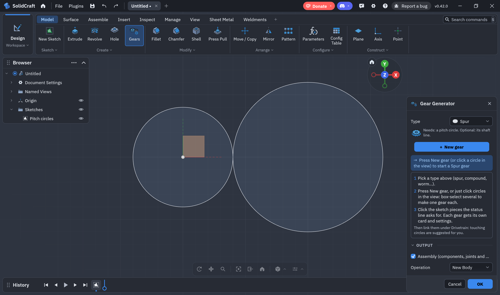
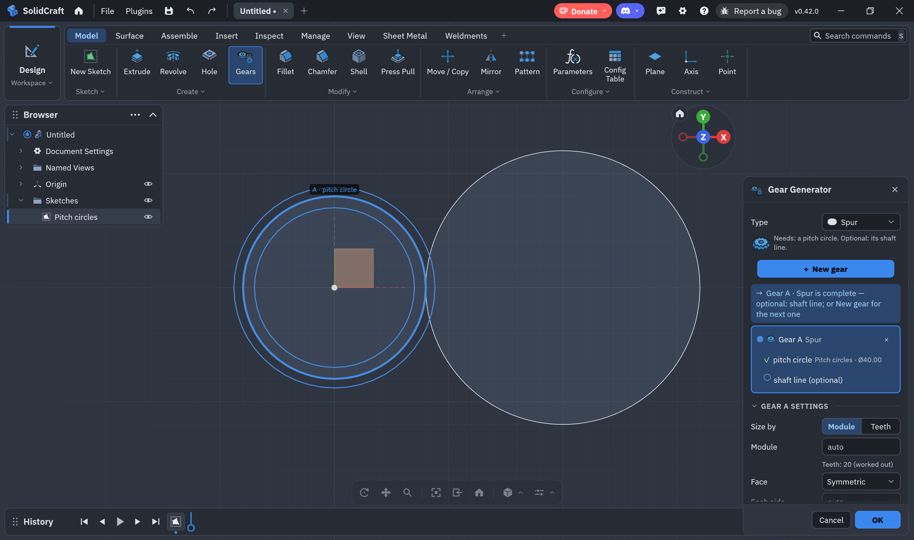
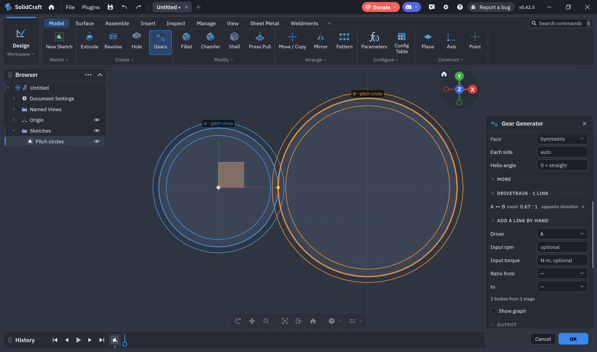
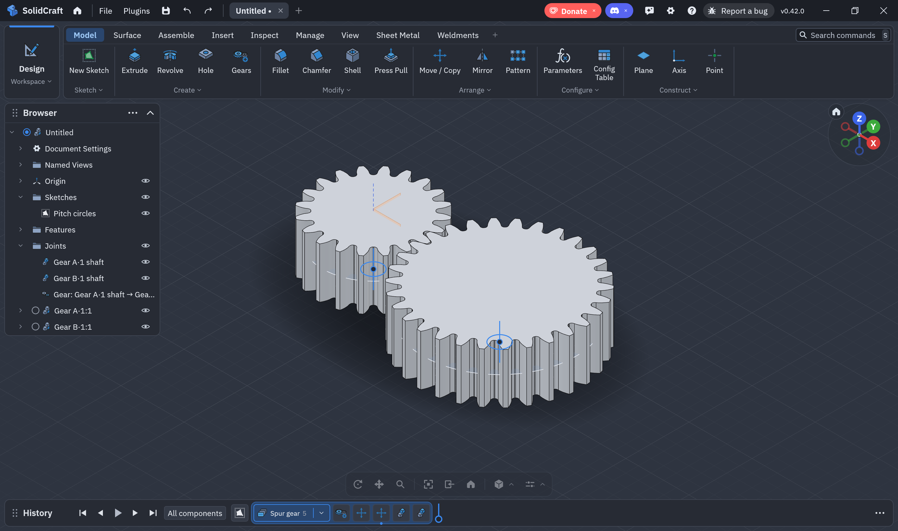

# Quick start: a spur pair in two minutes

You will draw two touching circles, turn them into two meshing spur gears, and get an assembly
where turning one gear turns the other.

## 1. Draw the pitch circles

1. **New Sketch** on the XY plane.
2. Draw two circles side by side.
3. Constrain them:
   - put the first circle's centre on the origin (Coincident);
   - dimension the diameters: **Ø40** and **Ø60**;
   - make the two circles **Tangent**;
   - add a horizontal (or vertical) relation between the two centres so the second can't swing
     round the first.
4. Check that the sketch is fully defined (0 degrees of freedom), then finish it.

The circles are the **pitch circles**. The gears will have exactly these pitch diameters, and they
mesh because the circles touch.

## 2. Open Gears and pick the circles

Click **Model › Create › Gears**. The panel opens on its **Gears** tab, with the type list set to **Spur** and a short
guide.

- Click the **left circle** in the view. With no gear waiting for a pick, the click starts a new
  gear of the chosen type: **Gear A · Spur**. Its card shows a checklist: ✓ pitch circle (with the
  sketch name and Ø40), ○ shaft line (optional).
- The status line says: *Gear A · Spur is complete — optional: shaft line; or New gear for the next
  one*.

- Click the **right circle**. Gear A is complete and a circle doesn't fit it, so the click starts
  **Gear B**.

You can also press **+ New gear** first and then click; or box-select both circles at once to make
one gear per circle.

## 3. Link them

Open the **Links & Motion** tab (the motion-link icon in the tab row). Because the circles touch, the
dialog suggests the link: *A ⟷ B mesh · suggested*. Press **Accept suggested (1)**.

The link row now reads **A ⟷ B mesh 0.67 : 1 opposite**: B turns at 0.67 times A's speed, the
other way round.

## 4. Check the size

Back on the **Gears** tab, click Gear A's card. In the group **Gear A · Spur** under the cards:

- **Size by: Module**, **Module: auto**. The caption shows *Teeth: 20 (worked out)*. Auto picked
  module 2, the largest standard module that gives the smaller gear 17 teeth or more.
- Type `2` (or `2 mm`) to fix the module. Gear B follows: meshing gears share one module, so B
  gets 30 teeth.

Face width is Auto: about 10 × module (here 20 mm), split evenly on both sides of the sketch plane.

## 5. Build

Optional: on **Links & Motion**, under **Drive**, set **Driver** to **A**. Press **OK**.

You get:

- bodies **Gear A·1** and **Gear B·1**, each its own component;
- joints **Gear A·1 shaft** and **Gear B·1 shaft** (revolute) and a gear link between them;
- one row in the History timeline.

## 6. Try it

- **Turn it:** Assemble › Motion › **Drive Joints**, pick *Gear A·1 shaft*, change the angle. B
  turns −0.667 times as far.
- **Change it:** edit the sketch and set the Ø60 dimension to Ø72. Finish the sketch. B regrows
  (36 teeth at module 2) and stays meshed.
- **Edit it:** double-click a gear, or the timeline row, to reopen the dialog on the set.

Next: [Sketch conventions](sketch-conventions.md) for what else you can draw, or
[Gear types](gear-types.md).
